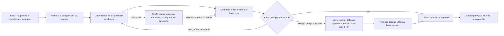

# 2 · Gameplay

[← Anterior: Visão Geral](./01-visao-geral.md) · [🏠 Índice](./README.md) · [Próximo: Conteúdo do Jogo →](./03-conteudo-do-jogo.md)

> **Versão do documento:** GDD v0.7.0 · **Data:** 2026-11-04

---

## 2.1 Core Loop (micro, macro e meta) + diagrama Mermaid

- **Micro (segundos):** mover/agir, avaliar ameaças, proteger ou atacar estruturas, coordenar com a equipe.
- **Macro (minutos):** obter recursos, construir ou melhorar defesas, empregar tanques/aviões e abrir caminho até o núcleo inimigo. **Aos 5 min, surge no centro um chefe neutro de 300 m que ataca quem se aproxima.**
- **Meta (sessões):** desbloquear conteúdo de história e lore; progresso competitivo persistente **[PENDENTE — não incluir ranking no MVP]**.

**[SUPOSIÇÃO]** A batalha acontece em tempo real. Não haverá pausa individual em partidas online.

---

## 2.2 Mecânicas principais (tabela com ID)

Os detalhes marcados **[PROPOSTA]** são valores iniciais para prototipagem, não balanceamento aprovado.

| ID | Mecânica | Descrição | Entrada | Regras/Parâmetros | Feedback | Critério de aceite |
|---|---|---|---|---|---|---|
| MEC-001 | Equipes 3v3 | Três jogadores por lado na versão online. | Mouse/teclado, lobby | 6 vagas humanas; bots permitidos para testes [PROPOSTA]. | Placar 3v3, estado de conexão e time. | Dado um lobby 3v3 válido, quando seis clientes entram, então cada cliente vê os mesmos times e o servidor inicia uma única partida. |
| MEC-002 | Personagem e movimentação | Cada jogador controla um personagem/piloto [PROPOSTA]. | WASD + mouse | Movimento top-down; valores em 2.11. | Animação, som e indicador de direção. | Dado um personagem ativo, quando recebe uma direção válida, então move-se dentro dos limites do mapa sem atravessar bloqueios. |
| MEC-003 | Ataque e habilidade | Ataques e habilidade de personagem afetam unidades/estruturas segundo alcance, recarga e dano. | Clique esquerdo / tecla E [PROPOSTA]. | Servidor valida alvos, cooldown e dano. | Projétil/efeito, barra de vida e som em até 100 ms percebidos. | Dado um ataque dentro do alcance e fora de recarga, quando chega ao servidor, então o alvo perde exatamente o dano validado pelo servidor. |
| MEC-004 | Torres de defesa | Atacam inimigos automaticamente, um alvo por vez [interpretação a confirmar]; protegem a base [regra de proteção ainda proposta]. | Loja/construção [PROPOSTA]. | **25.000 HP**, dividido visualmente em 5 segmentos de **5.000 HP** cada; quantidade/posições [PENDENTE]. Alvo e prioridade [PENDENTE]. | Barra com 5 segmentos, disparo no alvo e explosão na morte súbita. | Dado que a torre tem 25.000 HP, quando perde HP, então a barra mostra 5 segmentos de 5.000; dado um inimigo válido, então a torre ataca no máximo um alvo por vez. |
| MEC-005 | Torre principal | Objetivo de vitória de cada equipe; também ataca inimigos automaticamente, um alvo por vez [interpretação a confirmar]. | Ataques próprios e de unidades/jogadores | **45.000 HP**, valor confirmado; barra contínua, sem segmentos. Alvo, alcance e prioridade [PENDENTE]. Ao chegar a 0 HP antes da morte súbita, a equipe atacante vence. | Barra contínua destacada, disparo e alerta de base sob ataque. | Dado um inimigo válido, então a torre principal pode atacar somente um alvo por vez; dado que chega a 0 HP, então o servidor encerra a partida uma única vez. |
| MEC-006 | Tanque e avião | Unidades com papéis diferentes, terrestre e aéreo. | Comando de unidade [PROPOSTA]. | Tanque: mais resistente e lento; avião: rápido e menos resistente. Stats exatos em 2.11. | Silhuetas/ícones distintos, seleção e ordem visível. | Dado um comando válido, quando emitido, então somente a unidade da equipe executa a ordem autorizada. |
| MEC-007 | Recursos, loja e upgrades | Recursos compram unidades/torres e melhorias. | Mouse/UI React | Economia compartilhada por equipe [SUPOSIÇÃO]; fontes/sumidouros em 2.8. | Custo e saldo sempre visíveis; compra sem saldo é bloqueada. | Dado saldo inferior ao custo, quando o jogador tenta comprar, então nada é debitado e a UI explica o motivo. |
| MEC-008 | Morte súbita | Regra especial ao completar 30 min sem vencedor. | Relógio do servidor | Torres de defesa explodem; torres principais de ambas equipes passam a **1 HP**; primeiro ataque válido que acerta uma base decide. | Sirene, aviso visual não dependente só de cor, transição clara. | Dado que o relógio alcança 30:00 sem vitória, quando o servidor entra em morte súbita, então destrói defesas e ajusta cada base para 1 HP uma única vez. |
| MEC-009 | Traços animal/máquina | Personagens combinam traços visuais e habilidades inspirados em animais ou máquinas. | Seleção de personagem | Sistema de traços/combinações [PROPOSTA]; não copiar IP de terceiros. | Silhueta, ícone, nome e efeito de habilidade diferenciados. | Dado dois personagens com traços diferentes, quando selecionados, então cada um comunica sua habilidade sem depender apenas da cor. |
| MEC-010 | Animações de espera | Sem input, o personagem pode sentar, olhar ao redor ou fazer outra animação. | Ausência de input | Apenas cosmético; não altera combate nem espera 10 minutos como regra de jogo. | Animação sutil, interrompida imediatamente por input. | Dado personagem parado, quando a animação idle inicia, então qualquer input de movimento a interrompe sem atraso percebido. |
| MEC-011 | História e lore | Modo narrativo com missões e descoberta gradual de lore. | Menu História | Prólogo curto no primeiro recorte; campanha completa futura. | Texto legível, registro opcional do conteúdo descoberto. | Dado que o jogador completa a missão narrativa, quando chega ao resultado, então o próximo trecho desbloqueado é registrado localmente. |
| MEC-012 | Chefe neutro gigante | Aos 5 min decorridos [timing proposto a validar], surge no centro do mapa; ataca qualquer jogador/unidade que entre em seu raio de aproximação [raio e seleção de alvo pendentes]. | Movimento/ordens da equipe | Altura de lore confirmada: **300 m**; aviso aos **4:30** e surgimento proposto aos **5:00**. Ataca uma entidade por vez [SUPOSIÇÃO]. HP, dano e raio [PENDENTES]. A equipe do jogador que der o golpe final recebe por **90 s** +15% velocidade e +5% dano [DECIDIDO]. | Aviso antes da entrada, telegraph de ataque, barra de vida e ícone/temporizador do bônus. | Dado que a partida alcança 05:00 e o chefe ainda não surgiu, quando o servidor processa o marco, então cria exatamente um chefe no centro; quando um alvo válido entra no raio, então o chefe inicia ataque validado pelo servidor. |
| MEC-013 | Seleção pré-partida de personagem | Cada um dos seis jogadores escolhe um personagem da lista antes da partida; as duas equipes fazem a mesma etapa. | UI React de seleção | Uma escolha por jogador; confirmar antes de iniciar [PROPOSTA]. Repetição de personagem na mesma equipe [PENDENTE]. | Lista com personagem, habilidade, estado selecionado/pronto e composição das duas equipes. | Dado seis jogadores em seleção, quando cada jogador escolhe e confirma um personagem, então o servidor associa uma escolha a cada vaga e inicia a partida somente quando todas as escolhas forem válidas. |

---

## 2.3 Controles e input (teclado/mouse/touch/gamepad) + tabela de mapeamento

**Desktop no MVP [SUPOSIÇÃO].** Usar ações abstratas para permitir remapeamento. Touch/gamepad ficam fora do primeiro protótipo.

| Ação | Teclado | Mouse | Observação |
|---|---|---|---|
| Mover | WASD | — | Velocidade normalizada na diagonal. |
| Mirar/selecionar | — | Ponteiro | Alvo e alcance indicados antes de confirmar. |
| Ataque básico | Espaço ou botão esquerdo | Botão esquerdo | Confirmar no playtest. |
| Habilidade | E | Clique em botão de habilidade | Recarga exibida numericamente e visualmente. |
| Ordem de unidade | Q | Clique em unidade e destino | [PROPOSTA]; validar facilidade de uso. |
| Construção/loja | B | Botão de construção | React apresenta custo e disponibilidade. |
| Pausa (protótipo offline) | Esc | Botão UI | Desabilitada para cada jogador em partida online; abrir menu sem pausar a simulação. |
| Ping de equipe | G | Clique no mapa | Pings predefinidos; sem chat livre no MVP. |

---

## 2.4 Câmera e visão (tipo, follow, zoom, bounds, shake)

- Câmera 2D top-down; seguir personagem local com suavização leve [PROPOSTA].
- Limites definidos pelo mapa; **zoom padrão fixo** para manter campo de visão comparável entre jogadores.
- Shake curto e configurável ao receber dano; **desligável em acessibilidade**.
- Não ocultar torres, alertas ou projéteis essenciais fora da área visível; incluir **minimapa** [SHOULD].

---

## 2.5 Física e colisões (gravidade, atrito, layers, hitboxes)

- Sem gravidade; movimento top-down com **Arcade Physics**.
- Camadas: `ground`, `collision`, `structures`, `units`, `projectiles`, `effects`, `ui`.
- **Hitboxes separadas da arte.** Servidor valida alcance e colisão essencial para dano; cliente pode prever movimento visual, **nunca declarar vitória/dano**.
- Usar delta time na simulação local e **tick fixo no servidor**. Mapas Tiled (`.tmj`) com propriedades de colisão.

---

## 2.6 Regras de vitória, derrota, continue e respawn

- **Vitória:** reduzir a torre principal adversária a 0 HP antes da morte súbita, ou acertá-la durante a morte súbita.
- **Derrota:** torre principal da equipe chega a 0 HP.
- **Relógio:** 30:00 de tempo de partida, **controlado pelo servidor**. Ao fim, se não houver vencedor, iniciar morte súbita.
- **Morte súbita confirmada:** todas as torres de defesa explodem; cada torre principal é ajustada para **1 HP**. O primeiro ataque válido à base encerra a partida. Caso duas bases recebam o golpe no mesmo tick, **[PROPOSTA] empate**, registrado pelo servidor; validar com o usuário.
- **Respawn de personagem:** [PROPOSTA] 8 s; não reduz HP das bases ao respawn. Se todos os jogadores de uma equipe desconectarem, conceder **janela de reconexão** antes de derrota por abandono [PENDENTE de valor].
- Não há continue em partida competitiva; revanche inicia nova sala.

---

## 2.7 Progressão e desbloqueios

- **Durante a partida:** recursos permitem escolhas de unidade, defesa e upgrade.
- **Fora da partida:** história/lore desbloqueada por missões. Save local versionado no protótipo.
- Vantagens persistentes que alterem força no PvP ficam **fora do MVP** para evitar pay-to-win e desequilíbrio.
- Desbloqueios competitivos devem ser **cosméticos ou opções laterais equilibradas** [PROPOSTA].

---

## 2.8 Economia e recompensas (fontes, sumidouros, curvas)

Economia ainda sem valores confirmados. Modelo inicial [PROPOSTA]: recurso **compartilhado por equipe**, ganho passivo pequeno por minuto e por objetivos/unidades derrotadas; gastos em construção, reposição de unidade e upgrade. **Nenhum gasto pode ser obrigatório para acessar partida ou história.**

| Fonte | Sumidouro | Regra proposta | Risco a testar |
|---|---|---|---|
| Geração passiva | Unidade/torre | Credita em intervalos fixos no servidor. | Vantagem excessiva para equipe que já lidera. |
| Objetivo do mapa | Upgrade | Recompensa por controle/objetivo, não apenas por abate. | Snowball; ajustar valor e duração. |
| Abate de unidade inimiga | Reforço | Recompensa pequena, validada pelo servidor. | Incentivar jogo agressivo sem objetivo. |
| — | Defesa/upgrade | Custo explícito antes da confirmação. | Upgrade dominante ou escolha obrigatória. |

---

## 2.9 Dificuldade, curva de aprendizado e tutorial (onboarding)

- Tutorial curto, jogável, com movimentação, ataque, objetivo da base, compra e **regra da morte súbita**.
- Dificuldade selecionável em modo história e bots; **não associada automaticamente à idade**.
- Em PvP, pareamento por habilidade/latência quando houver infraestrutura suficiente, **não por idade informada**. Evitar coletar data de nascimento no MVP.
- Tutorial-alvo: **até 90 s** para controles básicos; explicar morte súbita antes da primeira partida online.

---

## 2.10 Sistemas de suporte (pontuação, combos, conquistas, missões)

- **Placar da equipe:** dano a estruturas, defesa, unidades derrotadas e objetivos; sem premiar apenas abates.
- **Resumo pós-partida:** resultado, duração, dano às bases, recursos gastos e contribuição por categoria.
- **Missões de história e conquistas simples locais** [SHOULD].
- **Pings predefinidos** para coordenação; sem chat de texto/voz no MVP.

---

## 2.11 Balanceamento inicial (tabela de parâmetros tunáveis com valores padrão, min e max)

Valores do usuário são decisões; demais parâmetros são provisórios e precisam de playtest. HP em "pontos de vida" abstratos.

| Parâmetro | Valor padrão | Mín | Máx | Unidade | Observação |
|---|---:|---:|---:|---|---|
| Jogadores por equipe | 3 | 3 | 3 | jogadores | Confirmado: 3v3. |
| Limite da partida | 30 | 10 | 45 | min | Confirmado. Ajustável somente após teste. |
| HP torre de defesa | 25.000 | 1 | 100.000 | HP | Confirmado pelo usuário. |
| Segmentos da barra de torre de defesa | 5 | 5 | 5 | segmentos | [DECIDIDO]: 25.000 ÷ 5 = 5.000 HP por segmento. |
| HP torre principal | 45.000 | 1 | 150.000 | HP | Confirmado pelo usuário. |
| HP base na morte súbita | 1 | 1 | 1 | HP | Regra confirmada. |
| Torres de defesa por equipe | 2 | 1 | 4 | torres | [SUPOSIÇÃO]; número ainda pendente. |
| Velocidade do personagem | 220 | 120 | 320 | px/s | [PROPOSTA]. |
| HP do personagem | 5.000 | 2.000 | 10.000 | HP | [PROPOSTA], requer simulação. |
| Dano básico | 500 | 100 | 1.500 | HP/hit | [PROPOSTA]. |
| Respawn | 8 | 3 | 20 | s | [PROPOSTA]. |
| Tick autoritativo do servidor | 20 | 10 | 30 | Hz | [PROPOSTA técnica]. |
| Frequência de snapshots | 10 | 5 | 20 | Hz | [PROPOSTA técnica]. |
| Recursos iniciais por equipe | 1.000 | 0 | 5.000 | créditos | [PROPOSTA]. |
| Surgimento do chefe neutro | 5 | 5 | 15 | min decorridos | Intenção atual do usuário; testar 5 min versus 10–15 min, pois o chefe é evitável enquanto ninguém se aproxima. |
| Altura canônica do chefe | 300 | 300 | 300 | m | Confirmada pelo usuário; escala visual no mapa deve preservar leitura. |
| HP / raio de aggro / dano do chefe | Pendente | — | — | HP / px / HP/s | Definir em playtest; **não inventar valor de produção**. |
| Duração do bônus por derrotar o chefe | 90 | 30 | 180 | s | Confirmado pelo usuário. |
| Bônus de velocidade da equipe do golpe final | +15% | 0% | +30% | % | Confirmado pelo usuário; dura 90 s. |
| Bônus de dano da equipe do golpe final | +5% | 0% | +20% | % | Confirmado pelo usuário; dura 90 s. |
| Geração de recursos | 300 | 0 | 1.000 | créditos/min | [PROPOSTA]. |

---

[← Anterior: Visão Geral](./01-visao-geral.md) · [🏠 Índice](./README.md) · [Próximo: Conteúdo do Jogo →](./03-conteudo-do-jogo.md)
