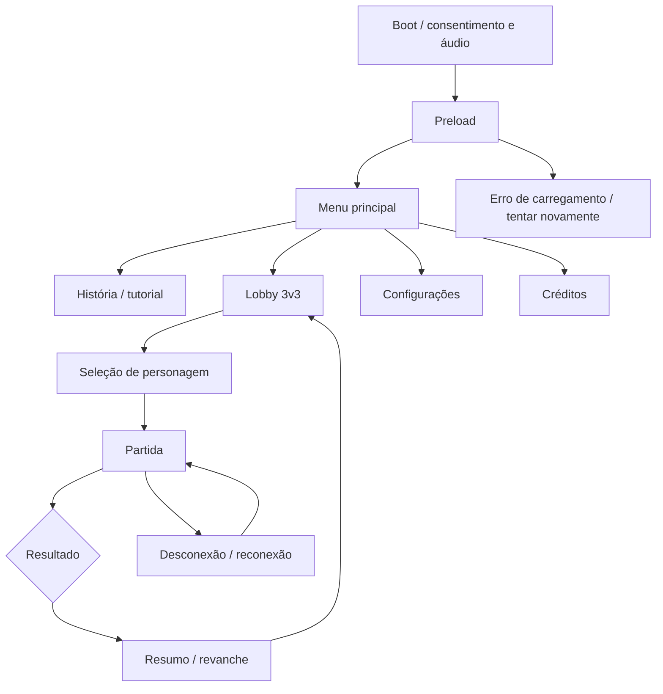

# 4 · Interface e Experiência (UX/UI)

[← Anterior: Conteúdo do Jogo](./03-conteudo-do-jogo.md) · [🏠 Índice](./README.md) · [Próximo: Arte e Direção Visual →](./05-arte-e-direcao-visual.md)

> **Versão do documento:** GDD v0.7.0 · **Data:** 2026-11-04

---

## 4.1 Fluxo de telas: Boot → Preload → Menu → Jogo → Pausa → Game Over → Créditos



**Pausa offline disponível.** Em jogo online, `Esc` abre configurações **sem pausar** outros jogadores.

---

## 4.2 Wireframes textuais de cada tela

| ID | Tela | Conteúdo |
|---|---|---|
| UI-01 | **Menu** | Logo, História, Jogar online, Treino contra bots, Configurações, Créditos. |
| UI-02 | **Lobby** | Seis vagas, região/ping, pronto/não pronto e cancelar busca. **Não exibir idade.** |
| UI-03 | **Seleção** | Lista de personagens; cada jogador escolhe um, vê habilidade/resumo acessível e confirma. Mostrar escolhas das duas equipes e estado pronto; regra de repetição [PENDENTE]. |
| UI-04 | **Partida** | Arena central; HUD superior com 30:00 e vida das bases; painel de recursos/loja; indicadores de equipe, habilidade e ping. |
| UI-05 | **Pausa/configuração** | Áudio, remapeamento, acessibilidade, qualidade e sair; **não pausar partida online**. |
| UI-06 | **Resultado** | Vitória/derrota/empate, duração, objetivos, dano e opções de revanche/menu. |
| UI-07 | **História** | Briefing, missão, legendas, continuar e voltar. |
| UI-08 | **Erro de rede** | Mensagem simples, status de reconexão e opção de sair **sem ocultar o resultado da partida**. |

---

## 4.3 HUD: elementos, posição, comportamento responsivo

- **Topo:** cronômetro, HP das duas bases e indicador de morte súbita. Cada torre de defesa mostra **5 segmentos de 5.000 HP**; a barra da torre principal é **contínua**.
- **Lateral:** 3 jogadores por equipe, estado de conexão/respawn e pings.
- **Inferior:** HP/personagem, habilidade/cooldown, saldo e ações de construção.
- Atualização React **a cada mudança importante ou no máximo 10 Hz**; nunca por frame.
- Valores de HP também indicados **numericamente e por forma/barra**, sem depender apenas de cor.

---

## 4.4 Menus, configurações (áudio, controles, idioma, acessibilidade, qualidade gráfica)

Volume Master/Música/SFX, remapeamento, idioma inicial **pt-BR**, escala de UI, contraste, redução de movimento, shake e qualidade de partículas. Preferências salvas localmente. Login/loja de dinheiro real: **não aplicável ao MVP hobby**.

---

## 4.5 Feedback ao jogador (juice): partículas, screen shake, hit-stop, tweens, sons

Feedback visual/sonoro em ataque, dano, compra, torre destruída e início da morte súbita. **Hit-stop somente em PvE/offline**; não congelar simulação de todos na rede. Partículas limitadas e opção de reduzir efeitos. Confirmação de ação deve aparecer em **até 100 ms percebidos**, sem prometer latência de rede.

---

## 4.6 Acessibilidade

- Contraste textual alvo **WCAG 2.2 AA** (4,5:1 para texto comum); **não diferenciar equipes apenas por cor**.
- Remapeamento de teclado; legendas em história; escala de UI e redução de movimento/shake.
- Indicadores textuais/ícones para HP, cooldown e pings; **modo daltônico**.
- Áreas de toque **≥44×44 px** caso mobile seja aprovado depois.
- Aviso de flashes; **evitar flashes acima de 3/s**. Háptica mobile não entra no MVP desktop.

---

## 4.7 Localização / i18n (idiomas, chaves, formatos)

Idioma inicial **pt-BR**. Externalizar textos em chaves:

```text
menu.play_online
match.sudden_death
tower.hp
```

Projetar interface para expansão de texto **≥30%**; formatos por `Intl`. Outros idiomas **[PENDENTE]**.

---

[← Anterior: Conteúdo do Jogo](./03-conteudo-do-jogo.md) · [🏠 Índice](./README.md) · [Próximo: Arte e Direção Visual →](./05-arte-e-direcao-visual.md)
