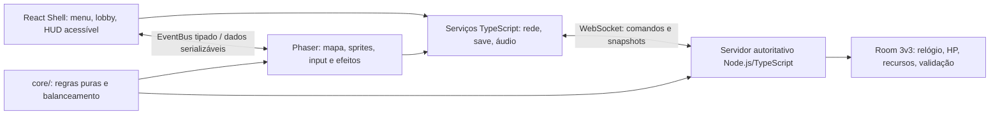

# 7 · Arquitetura Técnica (React + Phaser)

[← Anterior: Áudio](./06-audio.md) · [🏠 Índice](./README.md) · [Próximo: Monetização e Live Ops →](./08-monetizacao-e-live-ops.md)

> **Versão do documento:** GDD v0.7.0 · **Data:** 2026-11-04

---

## 7.1 Visão de arquitetura



**Regras invioláveis:**
- React **nunca** importa GameObjects Phaser; Phaser **nunca** importa componentes React.
- O **servidor**, não o navegador, decide dano, recursos, HP, resultado e morte súbita.

---

## 7.2 Stack e versões (com justificativa)

| Camada | Tecnologia proposta | Justificativa |
|---|---|---|
| Linguagem/build | TypeScript strict + Vite | Tipos compartilhados; build e HMR. |
| UI | React 18+ | Menus, lobby, HUD acessível e configurações. |
| Engine | Phaser 3.x estável, versão fixada no início | Cenas, câmera, input, colisão e renderização 2D. |
| Estado de UI | Zustand [PROPOSTA] | Estado leve e separado do mundo do jogo. |
| Regras puras | TypeScript em `core/` | Compartilhadas e testáveis no cliente/servidor; servidor continua autoridade. |
| Rede/servidor | Node.js + TypeScript; Colyseus ou WebSocket gerenciado [ADR-02 a validar] | Salas, sincronização e simulação autoritativa para 3v3. |
| Testes | Vitest, Testing Library, Playwright | Lógica, UI e fluxo de jogo. |
| Deploy | Vercel/Netlify para cliente; serviço de servidor com região próxima | Cliente estático não hospeda partida autoritativa por si só. Provedor/custo pendentes. |

---

## 7.3 Estrutura de pastas do projeto

```text
src/
├─ main.tsx
├─ App.tsx
├─ game/ (PhaserGame.tsx, config.ts, EventBus.ts, scenes/, entities/, systems/)
├─ core/ (match/, combat/, economy/, balance/)
├─ ui/ (screens/, components/, hooks/)
├─ store/
├─ services/ (network/, storage/, audio/, i18n/)
├─ assets/ (images/, atlases/, audio/, tilemaps/, fonts/)
└─ types/
server/
├─ src/ (rooms/, simulation/, validation/, matchmaking/)
└─ tests/
```

---

## 7.4 Cenas Phaser e responsabilidades

| Cena | Responsabilidade |
|---|---|
| `BootScene` | Configuração mínima e detecção de recursos. |
| `PreloadScene` | Carregar assets iniciais e progresso; erro com tentar novamente. |
| `MainMenuScene` | Opcional; animação de fundo apenas. **Menus reais em React.** |
| `GameScene` | Arena, câmera, representação de estado autoritativo, efeitos e colisões visuais. |
| `UIScene` | Opcional para HUD que precisa de sincronização de frame; **preferir React** para HUD acessível. |
| `GameOverScene` | Apresentação do resultado pode ser React; encerrar/limpar cena Phaser. |

Trocas explícitas com `scene.start/launch/pause/stop`; **partida online não é pausada por uma cena local**.

---

## 7.5 Ponte React ↔ Phaser: contrato de eventos

| Evento | Payload | Origem → destino | Uso |
|---|---|---|---|
| EVT-001 `scene:ready` | `{key:string}` | Phaser → React | Indicar cena carregada. |
| EVT-002 `ui:match-join` | `{mode: 'bots' or 'online'}` | React → serviço | Solicitar sessão. |
| EVT-003 `game:hp` | `{team: 'blue' or 'red'; structureId: string; current: number; max: number}` | Rede → React HUD | Atualizar HP em mudanças/batch. |
| EVT-004 `game:timer` | `{remainingMs:number; suddenDeath:boolean}` | Rede → React HUD | Mostrar relógio validado pelo servidor. |
| EVT-005 `game:command` | `{action:string; targetId?:string; x?:number; y?:number}` | Phaser/input → serviço | Enviar intenção, não resultado. |
| EVT-006 `game:result` | `{winner?: string; reason: string}`  <!-- ausente = empate --> | Servidor → React/Phaser | Resultado final autoritativo. |
| EVT-007 `ui:settings-changed` | `{master:number; music:number; sfx:number}` | React → serviço/Phaser | Atualizar mix. |
| EVT-008 `net:status` | `{state: 'connecting' or 'connected' or 'reconnecting' or 'disconnected'}` | Rede → React | Estado de ligação. |
| EVT-009 `lobby:select-character` | `{characterId:string}` | React → servidor | Solicitar escolha de personagem para a vaga do jogador. |
| EVT-010 `lobby:pick-state` | `{playerId:string; teamId:string; characterId?:string; ready:boolean}` | Servidor → React | Atualizar seleção e prontidão das duas equipes. |

**Contratos:** assinaturas no EventBus removidas em `SHUTDOWN`/`DESTROY`; **validar payloads em runtime** na fronteira de rede.

---

## 7.6 Gerenciamento de estado

| Onde | O que armazena |
|---|---|
| **React/Zustand** | Telas, modal, configurações, estado de lobby e dados serializáveis do HUD. |
| **Phaser** | Objetos visuais, câmera, animação, efeitos e input local. |
| **Registry** | Configuração imutável da sessão e referência a serviços tipados; **nunca** GameObjects. |
| **Servidor** | Estado canônico: equipes, timer, HP, dano, recursos, respawn, vitória e morte súbita. |
| **Storage local** | Configurações e progresso de história offline; **nunca autoridade de resultado online**. |

---

## 7.7 Entidades e padrões

FSM para fluxo, personagem e unidade; **composição de comportamentos** para unidades; **pooling** para projéteis/efeitos; dados de balanceamento em JSON/TS; comandos de rede representam **intenção** e são validados no servidor. Separar regras puras de apresentação. **RNG com seed** para testes reproduzíveis; servidor gera a seed da partida.

---

## 7.8 Pipeline de assets

Atlas JSON Hash/Array; texturas até 2048×2048; pacotes de menu/arena/história com lazy-loading; Tiled `.tmj`; OGG com fallback M4A; fonte carregada antes do Phaser. Prefixos `spr_`, `sfx_`, `bgm_`, `ui_`, `tm_`; **verificar licenças em CI** antes de release.

---

## 7.9 Persistência e save

```ts
type SaveV1 = {
  version: number;      // migrações versionadas
  updatedAt: string;
  progress: unknown;    // progresso de história/lore
  settings: unknown;    // áudio, controles, acessibilidade
};
```

Save local com **migrações versionadas**, fallback para arquivo corrompido e **sem PII**. Partida online é efêmera no MVP; resultado persistido no servidor apenas se ranking/contas forem aprovados depois. **Não armazenar credenciais em localStorage.**

---

## 7.10 Escala, resolução e responsividade

1280×720 lógica, paisagem, `Phaser.Scale.FIT` + `CENTER_BOTH`; resize tratado; limitar **DPR a 2**. Desktop web primeiro. Mobile, safe-area e controles touch **[Fora do MVP]**; se adicionados, áreas ≥44 px e prevenção de scroll no canvas.

---

## 7.11 Performance: orçamento

| Métrica | Desktop alvo inicial |
|---|---:|
| FPS render | 60 estável |
| TTI | <3 s (rede de referência a definir) |
| Bundle inicial gzip (sem Phaser) | <500 KB |
| Assets da primeira arena | <10 MB |
| Memória de texturas | <256 MB |
| Draw calls | <100/frame |
| Entidades físicas locais | <500 |
| Servidor | tick 20 Hz [PROPOSTA]; medir CPU/latência com 6 clientes |

Usar atlas, pooling, culling, **sem alocação por frame** e **sem re-render React por frame**. Medir em hardware real antes de fixar requisitos mínimos.

---

## 7.12 Backend e serviços: endpoints, autenticação, anti-cheat, LGPD

Backend **necessário** para 3v3 online. Componentes: criação/entrada em sala, seleção de equipe, início, envio de intenção de input, snapshots e resultado.

- Servidor valida **movimento, cooldown, alcance, dano, compra, vida, seleção/alvo dos ataques automáticos das torres e relógio**; rate limit e rejeição de comandos inválidos.
- Autenticação persistente **não é necessária** no primeiro teste; usar **token de sessão efêmero**.
- Provedor, região, disponibilidade e custo **[PENDENTE]**.
- Sem coleta de data de nascimento nem chat livre no MVP; rever **LGPD e proteção de menores** antes de teste público.

---

## 7.13 Telemetria e analytics

Métricas mínimas locais/de teste: partida iniciada/finalizada, duração, motivo de fim, desconexão e erro técnico. **Eventos sem nome, e-mail, idade exata ou conteúdo de chat.** Analytics externo apenas com consentimento, política de privacidade e retenção definida. **Não enviar telemetria de menores sem revisão legal.**

---

## 7.14 Estratégia de testes

| Nível | Ferramenta | Cobertura |
|---|---|---|
| Unitário | Vitest | Regra de HP, timer, morte súbita, dano simultâneo, economia e validação de comandos. |
| Integração de sala | Clientes simulados | 6 clientes, latência/perda de pacotes e reconexão. |
| UI | Testing Library | Lobby, HUD, configurações e acessibilidade. |
| E2E | Playwright | Menu → treino → resultado; lobby → partida simulada → morte súbita. |
| Debug | Build dev | Seed, overlay FPS, hitboxes e botões de teste. |
| Playtest | Sessões humanas | Mínimo **5 pessoas** por milestone; para 3v3, sessões com **seis** participantes quando viável. |

---

## 7.15 Build, CI/CD e deploy

Vite com chunks separados para Phaser/React; ambientes **dev/staging/prod**; `.env` sem segredo no cliente. CI: `lint`, `tsc --noEmit`, testes, build, checagem de **tamanho e licença**. Cliente estático em CDN; **servidor implantado separadamente** com WebSocket e logs. PWA não aplicável ao MVP online inicial; pode ser avaliada após validar conexão e cache.

---

## 7.16 Segurança e privacidade

HTTPS/WSS; **CSP**; validar tamanho/formato de payloads; rate limit; servidor autoritativo; **segredos só no servidor**; logs sem dados pessoais desnecessários. Minimização de dados, consentimento e política compatíveis com **LGPD**. Não solicitar idade, nome real ou contato no MVP; não incluir chat de texto/voz. Antes de abrir a menores, obter revisão de privacidade, moderação e segurança apropriada.

---

## 7.17 Decisões arquiteturais (ADR) e alternativas descartadas

| ADR | Decisão | Estado | Alternativas / motivo |
|---|---|---|---|
| ADR-01 | React para shell/UI; Phaser para mundo; EventBus tipado | Proposto | UI toda no canvas descartada por acessibilidade e separação. |
| ADR-02 | Servidor autoritativo Node/TS para PvP; avaliar Colyseus | Pendente de prova técnica | Cliente autoritativo descartado por permitir manipulação de dano/HP. |
| ADR-03 | Protótipo bots antes do online; provar rede antes do conteúdo extenso | Interpretado do "ok" do usuário; confirmar | Construir campanha toda antes da rede aumenta risco de retrabalho. |
| ADR-04 | 2D top-down e Arcade Physics | Proposto | Matter.js não necessário sem física complexa. |
| ADR-05 | Save local versionado; sem conta no protótipo | Proposto | Nuvem e login elevam custo/risco de privacidade. |

---

[← Anterior: Áudio](./06-audio.md) · [🏠 Índice](./README.md) · [Próximo: Monetização e Live Ops →](./08-monetizacao-e-live-ops.md)
