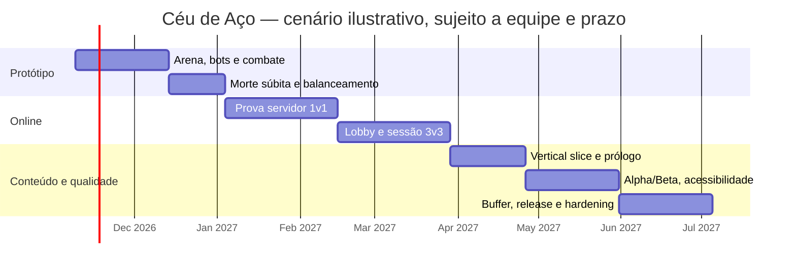

# 9 · Produção e Gestão

[← Anterior: Monetização e Live Ops](./08-monetizacao-e-live-ops.md) · [🏠 Índice](./README.md) · [Próximo: Qualidade e Testes →](./10-qualidade-testes-e-lancamento.md)

> **Versão do documento:** GDD v0.7.0 · **Data:** 2026-11-04

---

## 9.1 Equipe, papéis e responsabilidades (RACI simplificado)

**Equipe real [PENDENTE].** Papéis necessários, mesmo que uma pessoa acumule funções:

| Entrega | Game design | Cliente React/Phaser | Servidor/rede | Arte/áudio | QA |
|---|---|---|---|---|---|
| Regras e balanceamento | A/R | C | C | I | C |
| Cliente do jogo | C | A/R | C | C | C |
| Sala autoritativa | C | C | A/R | I | C |
| Assets/licenças | C | I | I | A/R | C |
| Aprovação de release | A | R | R | C | R |

`R` = responsável · `A` = aprovador · `C` = consultado · `I` = informado.

> Para iniciante solo: **reduzir escopo** e obter revisão técnica de networking antes de assumir 3v3 público.

---

## 9.2 Roadmap por milestones com critérios de saída

| Milestone | Conteúdo | Critério de saída |
|---|---|---|
| **Protótipo** | Arena blockout contra bots; movimento, ataque, HP, torres e timer. | Uma partida offline reproduzível; morte súbita passa nos testes; regra principal validada em playtest. |
| **Vertical Slice** | Uma arena polida; história curta; bot; prova de rede 1v1 e sessão 3v3 controlada. | Seis clientes simulados/testadores sincronizados; servidor autoritativo calcula HP, timer e resultado. |
| **Alpha** | Lobby, seleção, unidade, economia e versão 3v3 fechada. | Partida completa de 30 min/sudden death, reconexão básica e nenhum bug bloqueador conhecido. |
| **Beta** | Testes externos limitados, balanceamento, acessibilidade, privacidade e carga. | Crash-free ≥99% em sessões de teste; sem falha crítica de segurança; feedback priorizado. |
| **Release** | Build web, servidor monitorado, política/termos, créditos e suporte. | Checklist da [seção 10](./10-qualidade-testes-e-lancamento.md#105-checklist-de-lançamento) concluído; capacidade/custo do servidor aprovados. |

**Estimativa temporal: [PENDENTE]** — prazo, disponibilidade e equipe não foram informados. Planejar em **esforço/pontos** até esses dados serem definidos; adicionar **buffer de 30%** ao calendário aprovado.

---

## 9.3 Backlog inicial priorizado

Estimativas em **pontos de história (SP)**, relativas; **não equivalem a dias**.

| ID | História | Requisito | Prioridade | Estimativa | Dependência | DoD |
|---|---|---|---|---:|---|---|
| BKL-001 | Como jogador, quero uma arena navegável contra bots. | REQ-F-001, REQ-NF-001 | Must | 8 SP | — | Movimento/colisão testados; 60 FPS alvo medido. |
| BKL-002 | Como jogador, quero ver e danificar torres/base. | REQ-F-002, REQ-F-003 | Must | 5 SP | BKL-001 | Valores 25.000/45.000 usados; testes de HP passam. |
| BKL-003 | Como jogador, quero acionar morte súbita aos 30 min. | REQ-F-004 | Must | 5 SP | BKL-002 | Defesas explodem, bases ficam 1 HP e resultado único. |
| BKL-004 | Como jogador, quero comandar tanque e avião. | REQ-F-005 | Must | 8 SP | BKL-001 | Ordens válidas e papéis distinguíveis; testes de estado passam. |
| BKL-005 | Como equipe, quero recursos e upgrades simples. | REQ-F-006 | Should | 8 SP | BKL-002 | Saldo não negativo; compra inválida bloqueada. |
| BKL-006 | Como jogador, quero uma habilidade de personagem. | REQ-F-007 | Should | 8 SP | BKL-001 | Cooldown/dano validados no servidor simulado. |
| BKL-007 | Como jogador, quero tutorial e prólogo. | REQ-F-008 | Should | 8 SP | BKL-001 | Jogador testa objetivo e completa prólogo. |
| BKL-008 | Como equipe, queremos sincronizar uma partida online 1v1 de prova. | REQ-F-009, REQ-NF-002 | Must | 13 SP | BKL-001–004 | Servidor autoritativo e reconexão básica testados. |
| BKL-009 | Como seis jogadores, queremos entrar em partida 3v3. | REQ-F-010 | Must | 13 SP | BKL-008 | 6 clientes recebem estado consistente em staging. |
| BKL-010 | Como jogador, quero configurar áudio/controles/acessibilidade. | REQ-F-011, REQ-NF-003 | Should | 5 SP | BKL-001 | Preferências persistem; navegação e contraste revisados. |
| BKL-011 | Como equipe, queremos build e telemetria mínima sem PII. | REQ-F-012, REQ-NF-004 | Must | 8 SP | BKL-008 | CI passa; logs não contêm dados pessoais. |
| BKL-012 | Como jogador, quero enfrentar um chefe neutro que surge no meio da partida. | REQ-F-014, REQ-F-009 | Must | 8 SP | BKL-003, BKL-008 | Aviso aos 4:30; chefe surge aos 5 min de teste; aproximação/ataque validados no servidor. |
| BKL-013 | Como equipe, quero receber uma vantagem temporária ao derrotar o chefe. | REQ-F-015, REQ-NF-002 | Should | 3 SP | BKL-012 | Equipe do último golpe recebe +15% velocidade e +5% dano por 90 s; temporizador visível; sem acúmulo. |
| BKL-014 | Como jogador, quero escolher um personagem antes da partida 3v3. | REQ-F-016 | Must | 5 SP | BKL-009 | Cada uma das seis vagas tem escolha válida; escolhas sincronizadas; regra de repetição aplicada; partida só inicia com seleção completa. |

---

## 9.4 Cronograma (Mermaid Gantt)

**Cenário meramente ilustrativo [SUPOSIÇÃO]:** início em 2026-11-09, uma pessoa técnica experiente em tempo integral e colaboração de arte parcial. **Não é compromisso de prazo**; recalcular quando equipe/disponibilidade forem conhecidas. Incluir buffer final.

---

## 9.5 Definition of Ready / Definition of Done

**DoR**
- História tem requisito associado, regra testável, dono, dependências, estado [DECIDIDO]/[SUPOSIÇÃO] e critério de aceite.

**DoD por tarefa**
- Código tipado, revisão, teste pertinente, sem erro de console, acessibilidade aplicável verificada, sem segredo/PII, comportamento documentado.

**DoD de milestone**
- Critérios de saída de [9.2](#92-roadmap-por-milestones-com-critérios-de-saída) atendidos; build reproduzível; bugs críticos resolvidos; resultado de playtest registrado.

---

## 9.6 Gestão de riscos (prob × impacto × mitigação × dono)

| ID | Risco | Prob. | Impacto | Mitigação | Dono |
|---|---|---|---|---|---|
| RSK-01 | Escopo 3v3 online excede capacidade de portfólio | Alta | Alto | Provar rede cedo; bots antes; limitar a uma arena e dois tipos de unidade. | Produção/cliente |
| RSK-02 | Dessincronização ou trapaça altera HP/resultado | Média | Alto | Servidor autoritativo, validação/rate limit, testes de rede. | Backend |
| RSK-03 | Um time ganha vantagem irreversível (snowball) | Alta | Alto | Medir partidas, renda/objetivos de retorno e playtest. | Game design |
| RSK-04 | Regras de morte súbita causam empate/confusão | Média | Alto | Resolver golpe simultâneo no servidor; tutorial e teste de borda. | Design/backend |
| RSK-05 | Custos/latência do servidor são inviáveis | Média | Alto | Medir sala 6 jogadores em região-alvo antes de conteúdo amplo. | Produção/backend |
| RSK-06 | Dados/contato de menores são coletados sem necessidade | Baixa | Alto | Sem idade real/chat no MVP; revisão LGPD e minimização. | Produção/legal |
| RSK-07 | Assets sem licença clara | Média | Médio | Inventário AST/SFX/BGM e gate de licença no release. | Arte/produção |
| RSK-08 | Regras/valores ficam inconsistentes entre cliente e servidor | Média | Alto | Dados compartilhados versionados; testes de contrato. | Cliente/backend |
| RSK-09 | Chefe neutro aos 5 min favorece demais uma equipe ou cria snowball | Média | Alto | Playtests dos dois lados, recompensa compartilhada e parâmetros ajustáveis; não recompensar o último golpe de forma excessiva. | Game design/backend |

---

## 9.7 Orçamento e custos (se aplicável)

Custos de arte, áudio, domínio, hospedagem e tráfego **[PENDENTE — não fornecidos]**.

> Multiplayer implica **custo recorrente de servidor**; definir teto mensal e região antes do beta aberto. **Não assumir** que hospedagem estática do cliente cobre o servidor de jogo.

---

[← Anterior: Monetização e Live Ops](./08-monetizacao-e-live-ops.md) · [🏠 Índice](./README.md) · [Próximo: Qualidade e Testes →](./10-qualidade-testes-e-lancamento.md)
