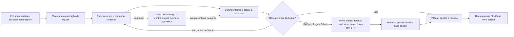
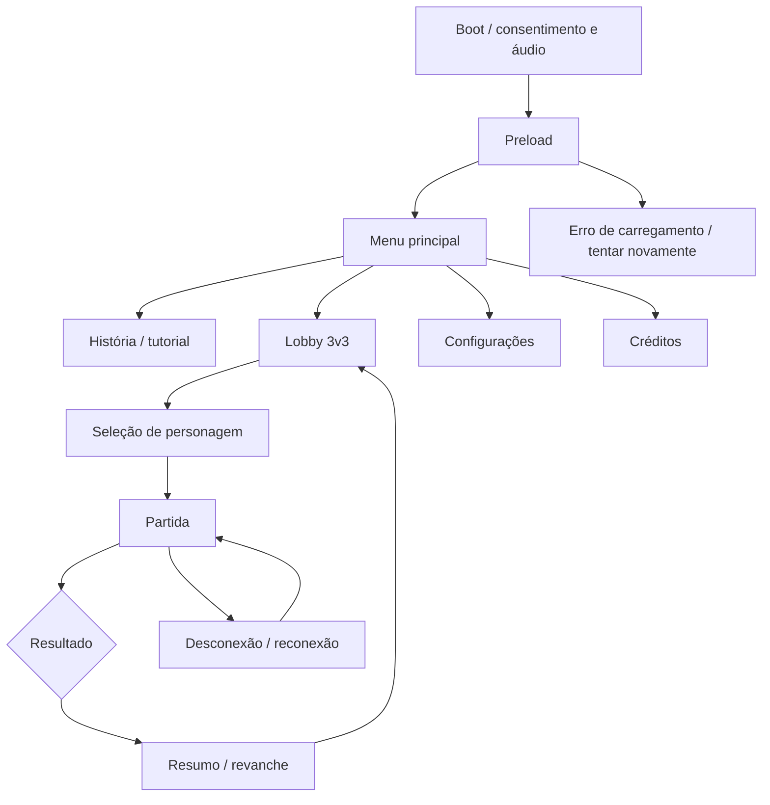
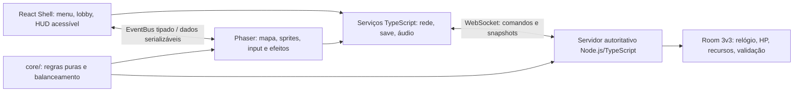
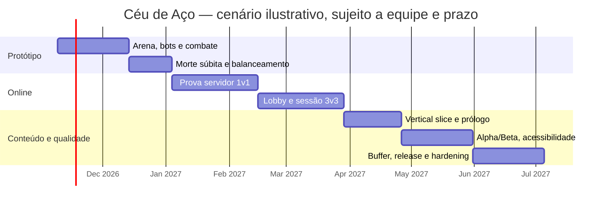

# GDD — Céu de Aço (documento completo)

> **Versão:** 0.7.0 · **Data:** 2026-11-04 · **Status:** Rascunho para validação
> **Autor(es):** usuário + GDD Architect

Este é o arquivo único com todas as seções do GDD, gerado a partir dos documentos divididos em `docs/`. Para navegação, comece pelo [índice](./README.md).

## Sumário

1. [Visão Geral](#1--visão-geral)
2. [Gameplay](#2--gameplay)
3. [Conteúdo do Jogo](#3--conteúdo-do-jogo)
4. [Interface e Experiência (UX/UI)](#4--interface-e-experiência-uxui)
5. [Arte e Direção Visual](#5--arte-e-direção-visual)
6. [Áudio](#6--áudio)
7. [Arquitetura Técnica (React + Phaser)](#7--arquitetura-técnica-react--phaser)
8. [Monetização e Live Ops](#8--monetização-e-live-ops)
9. [Produção e Gestão](#9--produção-e-gestão)
10. [Qualidade, Testes e Lançamento](#10--qualidade-testes-e-lançamento)
11. [Requisitos Consolidados](#11--requisitos-consolidados)
12. [Premissas, Riscos Abertos e Perguntas Pendentes](#12--premissas-riscos-abertos-e-perguntas-pendentes)
13. [Apêndices](#13--apêndices)

---

# 1 · Visão Geral

---

## 1.1 Elevator Pitch (máx. 50 palavras)

> *Céu de Aço* é um jogo 2D de estratégia espacial em que equipes de três jogadores coordenam personagens, tanques, aviões e torres para destruir a base inimiga. As partidas duram até 30 minutos; na morte súbita, as defesas explodem e as torres principais ficam com 1 ponto de vida.

---

## 1.2 Conceito de alto nível

Jogo de estratégia/defesa de base com partidas PvP online 3v3; antes da partida, cada jogador escolhe um personagem de uma lista. Inclui unidades terrestres e aéreas e personagens com habilidades inspiradas em animais e máquinas. O projeto também terá modo de história e lore. O primeiro protótipo valida a batalha contra bots; a meta de lançamento inclui o 3v3 online.

> ⚠️ **[PENDENTE]** A forma exata de controlar personagens e comandar unidades ainda é uma pendência de design.

---

## 1.3 Gênero, plataforma e público-alvo

- **Gênero:** estratégia em tempo real + defesa de base + ação tática `[SUPOSIÇÃO a partir do limite de 30 minutos, unidades e torres]`.
- **Plataforma:** desktop web, paisagem, teclado e mouse `[SUPOSIÇÃO aprovada como base do brief]`.
- **Stack:** React + Phaser + TypeScript + Vite.
- **Público:** fãs de estratégia e ficção científica. Faixa sugerida: 10+ `[SUPOSIÇÃO; validar classificação]`.
- **Dificuldade:** oferecer níveis selecionáveis. **Não usar idade informada para definir pareamento no MVP.**

---

## 1.4 Pilares de design

Os pilares abaixo são uma **[PROPOSTA]** derivada do brief; confirmar na próxima revisão.

1. **Estratégia com escolhas:** mais de uma composição deve poder vencer; decisões precisam ter resposta compreensível.
2. **Trabalho em equipe:** cada integrante do 3v3 contribui; a partida não deve ser decidida apenas por uma pessoa.
3. **Combate legível:** vida, alcance, perigo e estado da base são claros, inclusive para novos jogadores.
4. **Mundo original de aço e estrelas:** personagens, veículos e lore têm identidade própria; sem copiar personagens ou marcas existentes.

---

## 1.5 USP / Diferenciais

Combina partidas de base com **três jogadores por lado**, estruturas com **pontos de vida elevados**, unidades terrestres/aéreas e **heróis com traços animais ou mecânicos**.

> O diferencial precisa ser validado por playtests; **ainda não há pesquisa de mercado**.

---

## 1.6 Jogos de referência e diferenciação

- O usuário citou **Sonic** no contexto de personagens que fazem animações quando ficam parados. Isso fica registrado como referência de **animação de espera**, **não** como autorização para copiar personagens, arte, música ou mecânicas protegidas.
- Outras referências: **[PENDENTE — usuário ainda não indicou jogos de estratégia como referência]**.
- **Diferenciação:** guerra espacial original, equipes 3v3 e regra própria de morte súbita descrita em [2.6](./02-gameplay.md#26-regras-de-vitória-derrota-continue-e-respawn).

---

## 1.7 Experiência-alvo do jogador (emoções e fantasia de poder)

Sentir **desafio, cooperação e autoria estratégica**: escolher como contribuir para a equipe, defender a própria base e pressionar a base rival. A história e a lore devem recompensar a exploração fora das partidas competitivas.

---

## 1.8 Classificação indicativa prevista e justificativa

**[SUPOSIÇÃO] ClassInd 10**, sujeita a avaliação oficial. A premissa inclui guerra e combate ficcional, mas este GDD propõe **violência estilizada, sem gore, linguagem imprópria ou compra aleatória**. A classificação final depende dos conteúdos efetivamente produzidos e da avaliação aplicável.

---

## 1.9 Escopo: Dentro / Fora (MoSCoW)

| Prioridade | Escopo |
|---|---|
| **Must** | Protótipo de batalha contra bots; duas equipes; base principal e torres de defesa; tanques e aviões; personagens e habilidades; regra de partida de 30 min e morte súbita; prova técnica de rede; versão-alvo com 3v3 online; acessibilidade básica; save local de configurações. |
| **Should** | Uma arena competitiva; lobby e reconexão; loja simples de recursos/upgrades; prólogo de história com lore; bots para vagas de teste; pings predefinidos sem chat livre. |
| **Could** | Mais mapas, personagens, tipos de unidade, campanha maior, replay e estatísticas detalhadas. |
| **Won't (primeira versão)** | Chat de texto/voz, ranking competitivo, monetização, contas de menores, matchmaking por idade, clãs, cross-play mobile e multiplayer cooperativo PvE. |

**Plano de escopo:** "3v3 online" é requisito da versão-alvo. O "ok" do usuário foi interpretado como aceitação da rota **protótipo contra bots → 3v3 online antes do lançamento**; confirmar em revisão se a interpretação estiver errada (ver [Pendência 1](./12-pendencias-e-riscos.md)).

---

---

# 2 · Gameplay

---

## 2.1 Core Loop (micro, macro e meta) + diagrama Mermaid

- **Micro (segundos):** mover/agir, avaliar ameaças, proteger ou atacar estruturas, coordenar com a equipe.
- **Macro (minutos):** obter recursos, construir ou melhorar defesas, empregar tanques/aviões e abrir caminho até o núcleo inimigo. **Aos 5 min, surge no centro um chefe neutro de 300 m que ataca quem se aproxima.**
- **Meta (sessões):** desbloquear conteúdo de história e lore; progresso competitivo persistente **[PENDENTE — não incluir ranking no MVP]**.



**[SUPOSIÇÃO]** A batalha acontece em tempo real. Não haverá pausa individual em partidas online.

---

## 2.2 Mecânicas principais (tabela com ID)

Os detalhes marcados **[PROPOSTA]** são valores iniciais para prototipagem, não balanceamento aprovado.

| ID | Mecânica | Descrição | Entrada | Regras/Parâmetros | Feedback | Critério de aceite |
|---|---|---|---|---|---|---|
| MEC-001 | Equipes 3v3 | Três jogadores por lado na versão online. | Mouse/teclado, lobby | 6 vagas humanas; bots permitidos para testes [PROPOSTA]. | Placar 3v3, estado de conexão e time. | Dado um lobby 3v3 válido, quando seis clientes entram, então cada cliente vê os mesmos times e o servidor inicia uma única partida. |
| MEC-002 | Personagem e movimentação | Cada jogador controla um personagem/piloto [PROPOSTA]. | WASD + mouse | Movimento top-down; valores em 2.11. | Animação, som e indicador de direção. | Dado um personagem ativo, quando recebe uma direção válida, então move-se dentro dos limites do mapa sem atravessar bloqueios. |
| MEC-003 | Ataque e habilidade | Ataques e habilidade de personagem afetam unidades/estruturas segundo alcance, recarga e dano. | Clique esquerdo / tecla E [PROPOSTA]. | Servidor valida alvos, cooldown e dano. | Projétil/efeito, barra de vida e som em até 100 ms percebidos. | Dado um ataque dentro do alcance e fora de recarga, quando chega ao servidor, então o alvo perde exatamente o dano validado pelo servidor. |
| MEC-004 | Torres de defesa | Atacam inimigos automaticamente, um alvo por vez [interpretação a confirmar]; protegem a base [regra de proteção ainda proposta]. | Loja/construção [PROPOSTA]. | **25.000 HP**, dividido visualmente em 5 segmentos de **5.000 HP** cada; quantidade/posições [PENDENTE]. Alvo e prioridade [PENDENTE]. | Barra com 5 segmentos, disparo no alvo e explosão na morte súbita. | Dado que a torre tem 25.000 HP, quando perde HP, então a barra mostra 5 segmentos de 5.000; dado um inimigo válido, então a torre ataca no máximo um alvo por vez. |
| MEC-005 | Torre principal | Objetivo de vitória de cada equipe; também ataca inimigos automaticamente, um alvo por vez [interpretação a confirmar]. | Ataques próprios e de unidades/jogadores | **45.000 HP**, valor confirmado; barra contínua, sem segmentos. Alvo, alcance e prioridade [PENDENTE]. Ao chegar a 0 HP antes da morte súbita, a equipe atacante vence. | Barra contínua destacada, disparo e alerta de base sob ataque. | Dado um inimigo válido, então a torre principal pode atacar somente um alvo por vez; dado que chega a 0 HP, então o servidor encerra a partida uma única vez. |
| MEC-006 | Tanque e avião | Unidades com papéis diferentes, terrestre e aéreo. | Comando de unidade [PROPOSTA]. | Tanque: mais resistente e lento; avião: rápido e menos resistente. Stats exatos em 2.11. | Silhuetas/ícones distintos, seleção e ordem visível. | Dado um comando válido, quando emitido, então somente a unidade da equipe executa a ordem autorizada. |
| MEC-007 | Recursos, loja e upgrades | Recursos compram unidades/torres e melhorias. | Mouse/UI React | Economia compartilhada por equipe [SUPOSIÇÃO]; fontes/sumidouros em 2.8. | Custo e saldo sempre visíveis; compra sem saldo é bloqueada. | Dado saldo inferior ao custo, quando o jogador tenta comprar, então nada é debitado e a UI explica o motivo. |
| MEC-008 | Morte súbita | Regra especial ao completar 30 min sem vencedor. | Relógio do servidor | Torres de defesa explodem; torres principais de ambas equipes passam a **1 HP**; primeiro ataque válido que acerta uma base decide. | Sirene, aviso visual não dependente só de cor, transição clara. | Dado que o relógio alcança 30:00 sem vitória, quando o servidor entra em morte súbita, então destrói defesas e ajusta cada base para 1 HP uma única vez. |
| MEC-009 | Traços animal/máquina | Personagens combinam traços visuais e habilidades inspirados em animais ou máquinas. | Seleção de personagem | Sistema de traços/combinações [PROPOSTA]; não copiar IP de terceiros. | Silhueta, ícone, nome e efeito de habilidade diferenciados. | Dado dois personagens com traços diferentes, quando selecionados, então cada um comunica sua habilidade sem depender apenas da cor. |
| MEC-010 | Animações de espera | Sem input, o personagem pode sentar, olhar ao redor ou fazer outra animação. | Ausência de input | Apenas cosmético; não altera combate nem espera 10 minutos como regra de jogo. | Animação sutil, interrompida imediatamente por input. | Dado personagem parado, quando a animação idle inicia, então qualquer input de movimento a interrompe sem atraso percebido. |
| MEC-011 | História e lore | Modo narrativo com missões e descoberta gradual de lore. | Menu História | Prólogo curto no primeiro recorte; campanha completa futura. | Texto legível, registro opcional do conteúdo descoberto. | Dado que o jogador completa a missão narrativa, quando chega ao resultado, então o próximo trecho desbloqueado é registrado localmente. |
| MEC-012 | Chefe neutro gigante | Aos 5 min decorridos [timing proposto a validar], surge no centro do mapa; ataca qualquer jogador/unidade que entre em seu raio de aproximação [raio e seleção de alvo pendentes]. | Movimento/ordens da equipe | Altura de lore confirmada: **300 m**; aviso aos **4:30** e surgimento proposto aos **5:00**. Ataca uma entidade por vez [SUPOSIÇÃO]. HP, dano e raio [PENDENTES]. A equipe do jogador que der o golpe final recebe por **90 s** +15% velocidade e +5% dano [DECIDIDO]. | Aviso antes da entrada, telegraph de ataque, barra de vida e ícone/temporizador do bônus. | Dado que a partida alcança 05:00 e o chefe ainda não surgiu, quando o servidor processa o marco, então cria exatamente um chefe no centro; quando um alvo válido entra no raio, então o chefe inicia ataque validado pelo servidor. |
| MEC-013 | Seleção pré-partida de personagem | Cada um dos seis jogadores escolhe um personagem da lista antes da partida; as duas equipes fazem a mesma etapa. | UI React de seleção | Uma escolha por jogador; confirmar antes de iniciar [PROPOSTA]. Repetição de personagem na mesma equipe [PENDENTE]. | Lista com personagem, habilidade, estado selecionado/pronto e composição das duas equipes. | Dado seis jogadores em seleção, quando cada jogador escolhe e confirma um personagem, então o servidor associa uma escolha a cada vaga e inicia a partida somente quando todas as escolhas forem válidas. |

---

## 2.3 Controles e input (teclado/mouse/touch/gamepad) + tabela de mapeamento

**Desktop no MVP [SUPOSIÇÃO].** Usar ações abstratas para permitir remapeamento. Touch/gamepad ficam fora do primeiro protótipo.

| Ação | Teclado | Mouse | Observação |
|---|---|---|---|
| Mover | WASD | — | Velocidade normalizada na diagonal. |
| Mirar/selecionar | — | Ponteiro | Alvo e alcance indicados antes de confirmar. |
| Ataque básico | Espaço ou botão esquerdo | Botão esquerdo | Confirmar no playtest. |
| Habilidade | E | Clique em botão de habilidade | Recarga exibida numericamente e visualmente. |
| Ordem de unidade | Q | Clique em unidade e destino | [PROPOSTA]; validar facilidade de uso. |
| Construção/loja | B | Botão de construção | React apresenta custo e disponibilidade. |
| Pausa (protótipo offline) | Esc | Botão UI | Desabilitada para cada jogador em partida online; abrir menu sem pausar a simulação. |
| Ping de equipe | G | Clique no mapa | Pings predefinidos; sem chat livre no MVP. |

---

## 2.4 Câmera e visão (tipo, follow, zoom, bounds, shake)

- Câmera 2D top-down; seguir personagem local com suavização leve [PROPOSTA].
- Limites definidos pelo mapa; **zoom padrão fixo** para manter campo de visão comparável entre jogadores.
- Shake curto e configurável ao receber dano; **desligável em acessibilidade**.
- Não ocultar torres, alertas ou projéteis essenciais fora da área visível; incluir **minimapa** [SHOULD].

---

## 2.5 Física e colisões (gravidade, atrito, layers, hitboxes)

- Sem gravidade; movimento top-down com **Arcade Physics**.
- Camadas: `ground`, `collision`, `structures`, `units`, `projectiles`, `effects`, `ui`.
- **Hitboxes separadas da arte.** Servidor valida alcance e colisão essencial para dano; cliente pode prever movimento visual, **nunca declarar vitória/dano**.
- Usar delta time na simulação local e **tick fixo no servidor**. Mapas Tiled (`.tmj`) com propriedades de colisão.

---

## 2.6 Regras de vitória, derrota, continue e respawn

- **Vitória:** reduzir a torre principal adversária a 0 HP antes da morte súbita, ou acertá-la durante a morte súbita.
- **Derrota:** torre principal da equipe chega a 0 HP.
- **Relógio:** 30:00 de tempo de partida, **controlado pelo servidor**. Ao fim, se não houver vencedor, iniciar morte súbita.
- **Morte súbita confirmada:** todas as torres de defesa explodem; cada torre principal é ajustada para **1 HP**. O primeiro ataque válido à base encerra a partida. Caso duas bases recebam o golpe no mesmo tick, **[PROPOSTA] empate**, registrado pelo servidor; validar com o usuário.
- **Respawn de personagem:** [PROPOSTA] 8 s; não reduz HP das bases ao respawn. Se todos os jogadores de uma equipe desconectarem, conceder **janela de reconexão** antes de derrota por abandono [PENDENTE de valor].
- Não há continue em partida competitiva; revanche inicia nova sala.

---

## 2.7 Progressão e desbloqueios

- **Durante a partida:** recursos permitem escolhas de unidade, defesa e upgrade.
- **Fora da partida:** história/lore desbloqueada por missões. Save local versionado no protótipo.
- Vantagens persistentes que alterem força no PvP ficam **fora do MVP** para evitar pay-to-win e desequilíbrio.
- Desbloqueios competitivos devem ser **cosméticos ou opções laterais equilibradas** [PROPOSTA].

---

## 2.8 Economia e recompensas (fontes, sumidouros, curvas)

Economia ainda sem valores confirmados. Modelo inicial [PROPOSTA]: recurso **compartilhado por equipe**, ganho passivo pequeno por minuto e por objetivos/unidades derrotadas; gastos em construção, reposição de unidade e upgrade. **Nenhum gasto pode ser obrigatório para acessar partida ou história.**

| Fonte | Sumidouro | Regra proposta | Risco a testar |
|---|---|---|---|
| Geração passiva | Unidade/torre | Credita em intervalos fixos no servidor. | Vantagem excessiva para equipe que já lidera. |
| Objetivo do mapa | Upgrade | Recompensa por controle/objetivo, não apenas por abate. | Snowball; ajustar valor e duração. |
| Abate de unidade inimiga | Reforço | Recompensa pequena, validada pelo servidor. | Incentivar jogo agressivo sem objetivo. |
| — | Defesa/upgrade | Custo explícito antes da confirmação. | Upgrade dominante ou escolha obrigatória. |

---

## 2.9 Dificuldade, curva de aprendizado e tutorial (onboarding)

- Tutorial curto, jogável, com movimentação, ataque, objetivo da base, compra e **regra da morte súbita**.
- Dificuldade selecionável em modo história e bots; **não associada automaticamente à idade**.
- Em PvP, pareamento por habilidade/latência quando houver infraestrutura suficiente, **não por idade informada**. Evitar coletar data de nascimento no MVP.
- Tutorial-alvo: **até 90 s** para controles básicos; explicar morte súbita antes da primeira partida online.

---

## 2.10 Sistemas de suporte (pontuação, combos, conquistas, missões)

- **Placar da equipe:** dano a estruturas, defesa, unidades derrotadas e objetivos; sem premiar apenas abates.
- **Resumo pós-partida:** resultado, duração, dano às bases, recursos gastos e contribuição por categoria.
- **Missões de história e conquistas simples locais** [SHOULD].
- **Pings predefinidos** para coordenação; sem chat de texto/voz no MVP.

---

## 2.11 Balanceamento inicial (tabela de parâmetros tunáveis com valores padrão, min e max)

Valores do usuário são decisões; demais parâmetros são provisórios e precisam de playtest. HP em "pontos de vida" abstratos.

| Parâmetro | Valor padrão | Mín | Máx | Unidade | Observação |
|---|---:|---:|---:|---|---|
| Jogadores por equipe | 3 | 3 | 3 | jogadores | Confirmado: 3v3. |
| Limite da partida | 30 | 10 | 45 | min | Confirmado. Ajustável somente após teste. |
| HP torre de defesa | 25.000 | 1 | 100.000 | HP | Confirmado pelo usuário. |
| Segmentos da barra de torre de defesa | 5 | 5 | 5 | segmentos | [DECIDIDO]: 25.000 ÷ 5 = 5.000 HP por segmento. |
| HP torre principal | 45.000 | 1 | 150.000 | HP | Confirmado pelo usuário. |
| HP base na morte súbita | 1 | 1 | 1 | HP | Regra confirmada. |
| Torres de defesa por equipe | 2 | 1 | 4 | torres | [SUPOSIÇÃO]; número ainda pendente. |
| Velocidade do personagem | 220 | 120 | 320 | px/s | [PROPOSTA]. |
| HP do personagem | 5.000 | 2.000 | 10.000 | HP | [PROPOSTA], requer simulação. |
| Dano básico | 500 | 100 | 1.500 | HP/hit | [PROPOSTA]. |
| Respawn | 8 | 3 | 20 | s | [PROPOSTA]. |
| Tick autoritativo do servidor | 20 | 10 | 30 | Hz | [PROPOSTA técnica]. |
| Frequência de snapshots | 10 | 5 | 20 | Hz | [PROPOSTA técnica]. |
| Recursos iniciais por equipe | 1.000 | 0 | 5.000 | créditos | [PROPOSTA]. |
| Surgimento do chefe neutro | 5 | 5 | 15 | min decorridos | Intenção atual do usuário; testar 5 min versus 10–15 min, pois o chefe é evitável enquanto ninguém se aproxima. |
| Altura canônica do chefe | 300 | 300 | 300 | m | Confirmada pelo usuário; escala visual no mapa deve preservar leitura. |
| HP / raio de aggro / dano do chefe | Pendente | — | — | HP / px / HP/s | Definir em playtest; **não inventar valor de produção**. |
| Duração do bônus por derrotar o chefe | 90 | 30 | 180 | s | Confirmado pelo usuário. |
| Bônus de velocidade da equipe do golpe final | +15% | 0% | +30% | % | Confirmado pelo usuário; dura 90 s. |
| Bônus de dano da equipe do golpe final | +5% | 0% | +20% | % | Confirmado pelo usuário; dura 90 s. |
| Geração de recursos | 300 | 0 | 1.000 | créditos/min | [PROPOSTA]. |

---

---

# 3 · Conteúdo do Jogo

---

## 3.1 Personagem(ns) jogável(is): atributos, habilidades, estados, animações

Cada um dos **seis jogadores escolhe um personagem de uma lista antes da partida**; três escolhas para cada equipe, com o mesmo processo para o time inimigo. **[PROPOSTA]** O jogador controla o personagem escolhido. Tipos de traço podem ser **animal, mecânico ou híbrido**, afetando visual e habilidade.

> **[PENDENTE]** Lista final, tamanho do elenco e regra de repetição de personagem.

### Estados do personagem

| Estado | Descrição | Transição |
|---|---|---|
| `idle` | Parado; pode sentar/olhar ao redor após atraso cosmético [tempo pendente]. | Input válido → `move`. |
| `move` | Movimento e orientação para cursor/alvo. | Sem input → `idle`; ataque → `attack`. |
| `attack` | Animação e solicitação validada pelo servidor. | Fim da animação → `move`/`idle`. |
| `ability` | Habilidade única com cooldown. | Cooldown/efeito concluído → estado anterior. |
| `damaged` | Feedback visual breve; não bloquear controle excessivamente. | Após hit feedback → `move`/`idle`. |
| `defeated` | Aguarda respawn proposto de 8 s. | Respawn validado → `move`. |

**Animações mínimas:** idle, move, attack, ability, hit, defeated/respawn. A animação de espera **nunca** deve bloquear input ou conceder vantagem.

---

## 3.2 Inimigos / NPCs / Chefes: comportamento (FSM/Behavior), stats, telegraph

### Entidades

- **ENT-002 — Torre principal:** objetivo de cada equipe; **45.000 HP**; ataca inimigos automaticamente, **um por vez** [interpretação a confirmar]; barra de HP **contínua**. Estado validado pelo servidor.
- **ENT-003 — Torre de defesa:** **25.000 HP** cada, divididos em **5 segmentos de 5.000 HP**; quantidade/posicionamento [SUPOSIÇÃO: 2 por lado]. Ataca um inimigo válido por vez [interpretação a confirmar]. **Tipos de alvo e prioridade [PENDENTE].**
- **ENT-004 — Tanque:** unidade terrestre, lenta e resistente [PROPOSTA].
- **ENT-005 — Avião:** unidade aérea, rápida e menos resistente [PROPOSTA].
- **ENT-006 — NPCs:** unidades de rota/objetivo controladas por IA simples; comportamento exato [PENDENTE].
- **ENT-007 — Chefe neutro:** criatura gigante de **300 m**; aviso aos **4:30** e surgimento proposto aos **5:00** no centro da arena; ataca quem se aproxima. Escala visual adaptada para não cobrir HUD/arena. A equipe do jogador que acerta o **golpe final** ganha **+15% velocidade e +5% dano por 90 s**. HP, raio e dano do chefe continuam pendentes.

### FSM de unidade básica [PROPOSTA]

```text
Spawn → MoveToObjective → AcquireTarget → Telegraph → Attack → Recover → MoveToObjective
   └── (morte) ──> Defeated → Respawn/Remove
```

Ataques de alto dano devem ter **telegraph visual e sonoro** antes do impacto.

---

## 3.3 Itens, power-ups e coletáveis

| ID | Item | Descrição | Estado |
|---|---|---|---|
| ITM-001 | Créditos de equipe | Recurso abstrato para compras; saldo autoritativo. | Definido |
| ITM-002 | Upgrade de unidade | Altera um atributo dentro de limites; sem bônus oculto. | Definido |
| ITM-003 | Reparo | [PROPOSTA], custo e limite pendentes; **não pode reparar a base durante morte súbita**. | Pendente |

### Recompensa do chefe

A equipe que derrota o chefe recebe um **bônus coletivo de 90 s**: velocidade aumentada e um pouco mais de dano.

> **[DECIDIDO]** O servidor identifica a equipe do jogador que desfere o **golpe final** e concede **+15% velocidade** e **+5% dano** por **90 s**, **uma única vez**, sem acúmulo.

**Power-ups temporários:** não aplicáveis no primeiro protótipo — manter escopo simples.

---

## 3.4 Níveis / Mundos / Fases: lista, objetivo, novidades, duração estimada

| ID | Conteúdo | Objetivo | Duração |
|---|---|---|---|
| LVL-01 | Arena competitiva inicial | Testar 3v3, bases, torres, tanque/avião, chefe neutro aos 5 min e morte súbita. | Até 30 min + morte súbita; duração média a medir. |
| LVL-02 | Missão de prólogo | Ensinar controles contra bots e apresentar contexto da guerra/lore. | 5–8 min [PROPOSTA]. |
| LVL-03 | Cenário de teste de rede | Validar movimento, dano, reconexão e sincronização com poucos jogadores. | 5–10 min por rodada [PROPOSTA]. |

Uma **arena única** é suficiente para o primeiro lançamento de teste. Mapas adicionais ficam fora do MVP.

---

## 3.5 Level design: princípios, ritmo, teaching moments, ferramentas (Tiled)

- **Simetria inicial** entre os lados; distâncias equivalentes entre spawn, torres e base.
- Linhas de ataque e áreas de cobertura devem ser **legíveis**; não esconder ataque letal atrás de efeitos.
- **Tutorial:** apresentar movimento → ataque → torre → unidade → base → morte súbita.
- Arena construída em **Tiled** com camadas `ground`, `collision`, `structures`, `spawn`, `objectives`, `decor`; testar espelhamento dos lados.

---

## 3.6 Narrativa e personagens: sinopse, tom, diálogos, estrutura

O usuário confirmou **modo de história e lore**, mas ainda não forneceu trama, facções, nomes ou tom.

> **[PENDENTE — definir antes de produzir diálogo/arte final].**

**Proposta:** prólogo curto apresenta a guerra espacial e ensina controles; lore é entregue por cenas breves e registros opcionais. **Evitar exposition durante combate competitivo.**

---

---

# 4 · Interface e Experiência (UX/UI)

---

## 4.1 Fluxo de telas: Boot → Preload → Menu → Jogo → Pausa → Game Over → Créditos



**Pausa offline disponível.** Em jogo online, `Esc` abre configurações **sem pausar** outros jogadores.

---

## 4.2 Wireframes textuais de cada tela

| ID | Tela | Conteúdo |
|---|---|---|
| UI-01 | **Menu** | Logo, História, Jogar online, Treino contra bots, Configurações, Créditos. |
| UI-02 | **Lobby** | Seis vagas, região/ping, pronto/não pronto e cancelar busca. **Não exibir idade.** |
| UI-03 | **Seleção** | Lista de personagens; cada jogador escolhe um, vê habilidade/resumo acessível e confirma. Mostrar escolhas das duas equipes e estado pronto; regra de repetição [PENDENTE]. |
| UI-04 | **Partida** | Arena central; HUD superior com 30:00 e vida das bases; painel de recursos/loja; indicadores de equipe, habilidade e ping. |
| UI-05 | **Pausa/configuração** | Áudio, remapeamento, acessibilidade, qualidade e sair; **não pausar partida online**. |
| UI-06 | **Resultado** | Vitória/derrota/empate, duração, objetivos, dano e opções de revanche/menu. |
| UI-07 | **História** | Briefing, missão, legendas, continuar e voltar. |
| UI-08 | **Erro de rede** | Mensagem simples, status de reconexão e opção de sair **sem ocultar o resultado da partida**. |

---

## 4.3 HUD: elementos, posição, comportamento responsivo

- **Topo:** cronômetro, HP das duas bases e indicador de morte súbita. Cada torre de defesa mostra **5 segmentos de 5.000 HP**; a barra da torre principal é **contínua**.
- **Lateral:** 3 jogadores por equipe, estado de conexão/respawn e pings.
- **Inferior:** HP/personagem, habilidade/cooldown, saldo e ações de construção.
- Atualização React **a cada mudança importante ou no máximo 10 Hz**; nunca por frame.
- Valores de HP também indicados **numericamente e por forma/barra**, sem depender apenas de cor.

---

## 4.4 Menus, configurações (áudio, controles, idioma, acessibilidade, qualidade gráfica)

Volume Master/Música/SFX, remapeamento, idioma inicial **pt-BR**, escala de UI, contraste, redução de movimento, shake e qualidade de partículas. Preferências salvas localmente. Login/loja de dinheiro real: **não aplicável ao MVP hobby**.

---

## 4.5 Feedback ao jogador (juice): partículas, screen shake, hit-stop, tweens, sons

Feedback visual/sonoro em ataque, dano, compra, torre destruída e início da morte súbita. **Hit-stop somente em PvE/offline**; não congelar simulação de todos na rede. Partículas limitadas e opção de reduzir efeitos. Confirmação de ação deve aparecer em **até 100 ms percebidos**, sem prometer latência de rede.

---

## 4.6 Acessibilidade

- Contraste textual alvo **WCAG 2.2 AA** (4,5:1 para texto comum); **não diferenciar equipes apenas por cor**.
- Remapeamento de teclado; legendas em história; escala de UI e redução de movimento/shake.
- Indicadores textuais/ícones para HP, cooldown e pings; **modo daltônico**.
- Áreas de toque **≥44×44 px** caso mobile seja aprovado depois.
- Aviso de flashes; **evitar flashes acima de 3/s**. Háptica mobile não entra no MVP desktop.

---

## 4.7 Localização / i18n (idiomas, chaves, formatos)

Idioma inicial **pt-BR**. Externalizar textos em chaves:

```text
menu.play_online
match.sudden_death
tower.hp
```

Projetar interface para expansão de texto **≥30%**; formatos por `Intl`. Outros idiomas **[PENDENTE]**.

---

---

# 5 · Arte e Direção Visual

---

## 5.1 Estilo, referências e moodboard (descrição)

**[PROPOSTA]** 2D top-down de ficção científica, **silhuetas claras e leitura de batalha antes de detalhes**. Contraste entre metal, energia e biomas espaciais. Personagens podem combinar traços de animais e máquinas conforme pedido.

> **[PENDENTE]** Referências visuais específicas e paleta final.
> **Não usar** personagens, logos ou assets de *Sonic*.

---

## 5.2 Paleta de cores (hex) e tipografia

| Uso | Hex |
|---|---|
| Azul espacial (fundo) | `#101B36` |
| Aço (estruturas) | `#75849A` |
| Ciano aliado | `#43D9E6` |
| Âmbar adversário | `#F5A742` |
| Alerta | `#F15B64` |
| Texto | `#F4F6FA` |

Paleta provisória — **verificar contraste em fundos reais** (alvo WCAG 2.2 AA).

**Tipografia provisória:** sans-serif legível para UI; licença e família **[PENDENTE]**.

---

## 5.3 Especificações técnicas: resolução base, tiles/sprites, FPS de animação, formatos, atlas

| Item | Especificação |
|---|---|
| Resolução lógica | 1280×720, `Scale.FIT`, `CENTER_BOTH`, paisagem |
| Tiles | 64×64 px sugerido |
| Sprites | Dimensionados para legibilidade na câmera; **pixel art ainda não escolhida** |
| Animações | 8–12 FPS [PROPOSTA] |
| Render | 60 FPS desktop |
| Formato | PNG para sprites com transparência; WebP para fundos/UI quando suportado |
| Atlas | Até 2048×2048 (foco mobile futuro) |

---

## 5.4 Lista de assets visuais

| ID | Nome | Dimensões | Frames | Prioridade | Status | Origem/licença |
|---|---|---:|---:|---|---|---|
| AST-001 | Piloto base | A definir | 6 estados | Must | Placeholder | Pendente; criar/adquirir com licença registrada. |
| AST-002 | Tanque | A definir | 3 estados | Must | Placeholder | Pendente. |
| AST-003 | Avião | A definir | 3 estados | Must | Placeholder | Pendente. |
| AST-004 | Torre de defesa | A definir | 2 estados | Must | Placeholder | Pendente. |
| AST-005 | Torre principal | A definir | 3 estados | Must | Placeholder | Pendente. |
| AST-006 | Arena e tiles | 1280×720 lógica | — | Must | Blockout | Tiled; origem/licença pendente. |
| AST-007 | Efeitos de tiro/explosão | A definir | 4–8 | Should | Não iniciado | Pendente. |
| AST-008 | Ícones da UI | 32–64 px | — | Must | Não iniciado | Criar original/licença pendente. |

---

## 5.5 Animações e VFX

Idle (inclui sentar/olhar ao redor), movimento, ataque, dano, habilidade, destruição e respawn. **Explosões têm duração curta e não obscurecem telegraphs.** Redução de movimento desliga shake e reduz partículas.

---

## 5.6 Convenções de nomenclatura e pastas

| Prefixo | Uso |
|---|---|
| `spr_pilot_*`, `spr_tank_*`, `spr_aircraft_*`, `spr_tower_*` | Sprites/atlas |
| `bg_*` | Fundos |
| `ui_*` | Interface |
| `tm_*` | Tilemaps |
| `sfx_*`, `bgm_*` | Áudio |

Regras: **snake_case**; arquivos por atlas; licenças em `assets/licenses/`. Pasta recomendada em [7.3](./07-arquitetura-tecnica.md#73-estrutura-de-pastas-do-projeto).

---

---

# 6 · Áudio

---

## 6.1 Direção sonora e referências

**[PROPOSTA]** Ficção científica com percussão eletrônica e motivos de metal/energia. Referências específicas **[PENDENTE]**. A música deve **preservar a leitura de alertas da partida**.

---

## 6.2 Lista de SFX e músicas

| ID | Gatilho | Duração | Loop | Volume inicial | Formato |
|---|---|---:|---|---:|---|
| SFX-001 | Ataque básico | <1 s | Não | 0,7 | OGG + M4A fallback |
| SFX-002 | Torre recebe dano | <1 s | Não | 0,8 | OGG + M4A fallback |
| SFX-003 | Torre destruída | 1–2 s | Não | 0,9 | OGG + M4A fallback |
| SFX-004 | Início da morte súbita | 2–3 s | Não | 0,9 | OGG + M4A fallback |
| SFX-005 | Habilidade disponível/acionada | <1 s | Não | 0,6 | OGG + M4A fallback |
| BGM-01 | Menu | 1–3 min | Sim | 0,35 | OGG + M4A fallback |
| BGM-02 | Partida | 1–3 min | Sim | 0,3 | OGG + M4A fallback |
| BGM-03 | História | 1–3 min | Sim | 0,35 | OGG + M4A fallback |

Volumes relativos de teste; **sliders Master/Música/SFX** controlados pelo usuário.

---

## 6.3 Mixagem, ducking e regras de autoplay do navegador

- Desbloquear `AudioContext` **após gesto explícito** do usuário.
- Alertas de gameplay podem baixar a música em **até 6 dB** [PROPOSTA].
- Limitar polifonia; variar pitch levemente em SFX repetidos; respeitar mute e volume salvo.

---

## 6.4 Licenças e créditos

Nenhum áudio final está selecionado. **Registrar autor, licença, comprovante e atribuição** de cada arquivo antes do release. Não usar música de jogos existentes.

---

---

# 7 · Arquitetura Técnica (React + Phaser)

---

## 7.1 Visão de arquitetura



**Regras invioláveis:**
- React **nunca** importa GameObjects Phaser; Phaser **nunca** importa componentes React.
- O **servidor**, não o navegador, decide dano, recursos, HP, resultado e morte súbita.

---

## 7.2 Stack e versões (com justificativa)

| Camada | Tecnologia proposta | Justificativa |
|---|---|---|
| Linguagem/build | TypeScript strict + Vite | Tipos compartilhados; build e HMR. |
| UI | React 18+ | Menus, lobby, HUD acessível e configurações. |
| Engine | Phaser 3.x estável, versão fixada no início | Cenas, câmera, input, colisão e renderização 2D. |
| Estado de UI | Zustand [PROPOSTA] | Estado leve e separado do mundo do jogo. |
| Regras puras | TypeScript em `core/` | Compartilhadas e testáveis no cliente/servidor; servidor continua autoridade. |
| Rede/servidor | Node.js + TypeScript; Colyseus ou WebSocket gerenciado [ADR-02 a validar] | Salas, sincronização e simulação autoritativa para 3v3. |
| Testes | Vitest, Testing Library, Playwright | Lógica, UI e fluxo de jogo. |
| Deploy | Vercel/Netlify para cliente; serviço de servidor com região próxima | Cliente estático não hospeda partida autoritativa por si só. Provedor/custo pendentes. |

---

## 7.3 Estrutura de pastas do projeto

```text
src/
├─ main.tsx
├─ App.tsx
├─ game/ (PhaserGame.tsx, config.ts, EventBus.ts, scenes/, entities/, systems/)
├─ core/ (match/, combat/, economy/, balance/)
├─ ui/ (screens/, components/, hooks/)
├─ store/
├─ services/ (network/, storage/, audio/, i18n/)
├─ assets/ (images/, atlases/, audio/, tilemaps/, fonts/)
└─ types/
server/
├─ src/ (rooms/, simulation/, validation/, matchmaking/)
└─ tests/
```

---

## 7.4 Cenas Phaser e responsabilidades

| Cena | Responsabilidade |
|---|---|
| `BootScene` | Configuração mínima e detecção de recursos. |
| `PreloadScene` | Carregar assets iniciais e progresso; erro com tentar novamente. |
| `MainMenuScene` | Opcional; animação de fundo apenas. **Menus reais em React.** |
| `GameScene` | Arena, câmera, representação de estado autoritativo, efeitos e colisões visuais. |
| `UIScene` | Opcional para HUD que precisa de sincronização de frame; **preferir React** para HUD acessível. |
| `GameOverScene` | Apresentação do resultado pode ser React; encerrar/limpar cena Phaser. |

Trocas explícitas com `scene.start/launch/pause/stop`; **partida online não é pausada por uma cena local**.

---

## 7.5 Ponte React ↔ Phaser: contrato de eventos

| Evento | Payload | Origem → destino | Uso |
|---|---|---|---|
| EVT-001 `scene:ready` | `{key:string}` | Phaser → React | Indicar cena carregada. |
| EVT-002 `ui:match-join` | `{mode: 'bots' or 'online'}` | React → serviço | Solicitar sessão. |
| EVT-003 `game:hp` | `{team: 'blue' or 'red'; structureId: string; current: number; max: number}` | Rede → React HUD | Atualizar HP em mudanças/batch. |
| EVT-004 `game:timer` | `{remainingMs:number; suddenDeath:boolean}` | Rede → React HUD | Mostrar relógio validado pelo servidor. |
| EVT-005 `game:command` | `{action:string; targetId?:string; x?:number; y?:number}` | Phaser/input → serviço | Enviar intenção, não resultado. |
| EVT-006 `game:result` | `{winner?: string; reason: string}`  <!-- ausente = empate --> | Servidor → React/Phaser | Resultado final autoritativo. |
| EVT-007 `ui:settings-changed` | `{master:number; music:number; sfx:number}` | React → serviço/Phaser | Atualizar mix. |
| EVT-008 `net:status` | `{state: 'connecting' or 'connected' or 'reconnecting' or 'disconnected'}` | Rede → React | Estado de ligação. |
| EVT-009 `lobby:select-character` | `{characterId:string}` | React → servidor | Solicitar escolha de personagem para a vaga do jogador. |
| EVT-010 `lobby:pick-state` | `{playerId:string; teamId:string; characterId?:string; ready:boolean}` | Servidor → React | Atualizar seleção e prontidão das duas equipes. |

**Contratos:** assinaturas no EventBus removidas em `SHUTDOWN`/`DESTROY`; **validar payloads em runtime** na fronteira de rede.

---

## 7.6 Gerenciamento de estado

| Onde | O que armazena |
|---|---|
| **React/Zustand** | Telas, modal, configurações, estado de lobby e dados serializáveis do HUD. |
| **Phaser** | Objetos visuais, câmera, animação, efeitos e input local. |
| **Registry** | Configuração imutável da sessão e referência a serviços tipados; **nunca** GameObjects. |
| **Servidor** | Estado canônico: equipes, timer, HP, dano, recursos, respawn, vitória e morte súbita. |
| **Storage local** | Configurações e progresso de história offline; **nunca autoridade de resultado online**. |

---

## 7.7 Entidades e padrões

FSM para fluxo, personagem e unidade; **composição de comportamentos** para unidades; **pooling** para projéteis/efeitos; dados de balanceamento em JSON/TS; comandos de rede representam **intenção** e são validados no servidor. Separar regras puras de apresentação. **RNG com seed** para testes reproduzíveis; servidor gera a seed da partida.

---

## 7.8 Pipeline de assets

Atlas JSON Hash/Array; texturas até 2048×2048; pacotes de menu/arena/história com lazy-loading; Tiled `.tmj`; OGG com fallback M4A; fonte carregada antes do Phaser. Prefixos `spr_`, `sfx_`, `bgm_`, `ui_`, `tm_`; **verificar licenças em CI** antes de release.

---

## 7.9 Persistência e save

```ts
type SaveV1 = {
  version: number;      // migrações versionadas
  updatedAt: string;
  progress: unknown;    // progresso de história/lore
  settings: unknown;    // áudio, controles, acessibilidade
};
```

Save local com **migrações versionadas**, fallback para arquivo corrompido e **sem PII**. Partida online é efêmera no MVP; resultado persistido no servidor apenas se ranking/contas forem aprovados depois. **Não armazenar credenciais em localStorage.**

---

## 7.10 Escala, resolução e responsividade

1280×720 lógica, paisagem, `Phaser.Scale.FIT` + `CENTER_BOTH`; resize tratado; limitar **DPR a 2**. Desktop web primeiro. Mobile, safe-area e controles touch **[Fora do MVP]**; se adicionados, áreas ≥44 px e prevenção de scroll no canvas.

---

## 7.11 Performance: orçamento

| Métrica | Desktop alvo inicial |
|---|---:|
| FPS render | 60 estável |
| TTI | <3 s (rede de referência a definir) |
| Bundle inicial gzip (sem Phaser) | <500 KB |
| Assets da primeira arena | <10 MB |
| Memória de texturas | <256 MB |
| Draw calls | <100/frame |
| Entidades físicas locais | <500 |
| Servidor | tick 20 Hz [PROPOSTA]; medir CPU/latência com 6 clientes |

Usar atlas, pooling, culling, **sem alocação por frame** e **sem re-render React por frame**. Medir em hardware real antes de fixar requisitos mínimos.

---

## 7.12 Backend e serviços: endpoints, autenticação, anti-cheat, LGPD

Backend **necessário** para 3v3 online. Componentes: criação/entrada em sala, seleção de equipe, início, envio de intenção de input, snapshots e resultado.

- Servidor valida **movimento, cooldown, alcance, dano, compra, vida, seleção/alvo dos ataques automáticos das torres e relógio**; rate limit e rejeição de comandos inválidos.
- Autenticação persistente **não é necessária** no primeiro teste; usar **token de sessão efêmero**.
- Provedor, região, disponibilidade e custo **[PENDENTE]**.
- Sem coleta de data de nascimento nem chat livre no MVP; rever **LGPD e proteção de menores** antes de teste público.

---

## 7.13 Telemetria e analytics

Métricas mínimas locais/de teste: partida iniciada/finalizada, duração, motivo de fim, desconexão e erro técnico. **Eventos sem nome, e-mail, idade exata ou conteúdo de chat.** Analytics externo apenas com consentimento, política de privacidade e retenção definida. **Não enviar telemetria de menores sem revisão legal.**

---

## 7.14 Estratégia de testes

| Nível | Ferramenta | Cobertura |
|---|---|---|
| Unitário | Vitest | Regra de HP, timer, morte súbita, dano simultâneo, economia e validação de comandos. |
| Integração de sala | Clientes simulados | 6 clientes, latência/perda de pacotes e reconexão. |
| UI | Testing Library | Lobby, HUD, configurações e acessibilidade. |
| E2E | Playwright | Menu → treino → resultado; lobby → partida simulada → morte súbita. |
| Debug | Build dev | Seed, overlay FPS, hitboxes e botões de teste. |
| Playtest | Sessões humanas | Mínimo **5 pessoas** por milestone; para 3v3, sessões com **seis** participantes quando viável. |

---

## 7.15 Build, CI/CD e deploy

Vite com chunks separados para Phaser/React; ambientes **dev/staging/prod**; `.env` sem segredo no cliente. CI: `lint`, `tsc --noEmit`, testes, build, checagem de **tamanho e licença**. Cliente estático em CDN; **servidor implantado separadamente** com WebSocket e logs. PWA não aplicável ao MVP online inicial; pode ser avaliada após validar conexão e cache.

---

## 7.16 Segurança e privacidade

HTTPS/WSS; **CSP**; validar tamanho/formato de payloads; rate limit; servidor autoritativo; **segredos só no servidor**; logs sem dados pessoais desnecessários. Minimização de dados, consentimento e política compatíveis com **LGPD**. Não solicitar idade, nome real ou contato no MVP; não incluir chat de texto/voz. Antes de abrir a menores, obter revisão de privacidade, moderação e segurança apropriada.

---

## 7.17 Decisões arquiteturais (ADR) e alternativas descartadas

| ADR | Decisão | Estado | Alternativas / motivo |
|---|---|---|---|
| ADR-01 | React para shell/UI; Phaser para mundo; EventBus tipado | Proposto | UI toda no canvas descartada por acessibilidade e separação. |
| ADR-02 | Servidor autoritativo Node/TS para PvP; avaliar Colyseus | Pendente de prova técnica | Cliente autoritativo descartado por permitir manipulação de dano/HP. |
| ADR-03 | Protótipo bots antes do online; provar rede antes do conteúdo extenso | Interpretado do "ok" do usuário; confirmar | Construir campanha toda antes da rede aumenta risco de retrabalho. |
| ADR-04 | 2D top-down e Arcade Physics | Proposto | Matter.js não necessário sem física complexa. |
| ADR-05 | Save local versionado; sem conta no protótipo | Proposto | Nuvem e login elevam custo/risco de privacidade. |

---

---

# 8 · Monetização e Live Ops

---

## 8.1 Modelo de negócio e ética (sem dark patterns)

**Não aplicável** — objetivo informado: **portfólio/hobby**, sem modelo comercial definido. MVP gratuito para teste, **sem compras ou anúncios** [SUPOSIÇÃO].

---

## 8.2 Itens/ofertas, preços e economia

**Não aplicável** — a loja do jogo usa **recursos de partida**, não dinheiro real. Preços de upgrades são pendentes de balanceamento (ver [2.8](./02-gameplay.md#28-economia-e-recompensas-fontes-sumidouros-curvas) e [2.11](./02-gameplay.md#211-balanceamento-inicial-tabela-de-parâmetros-tunáveis-com-valores-padrão-min-e-max)).

---

## 8.3 Anúncios (frequência, placements, opt-in recompensado)

**Não aplicável** — sem anúncios planejados.

---

## 8.4 Eventos, atualizações e roadmap pós-lançamento

Pós-lançamento possível: **novos personagens, mapas, capítulos de história e ajustes de balanceamento**.

> Não prometer calendário até medir capacidade e **custo do servidor**.

---

---

# 9 · Produção e Gestão

---

## 9.1 Equipe, papéis e responsabilidades (RACI simplificado)

**Equipe real [PENDENTE].** Papéis necessários, mesmo que uma pessoa acumule funções:

| Entrega | Game design | Cliente React/Phaser | Servidor/rede | Arte/áudio | QA |
|---|---|---|---|---|---|
| Regras e balanceamento | A/R | C | C | I | C |
| Cliente do jogo | C | A/R | C | C | C |
| Sala autoritativa | C | C | A/R | I | C |
| Assets/licenças | C | I | I | A/R | C |
| Aprovação de release | A | R | R | C | R |

`R` = responsável · `A` = aprovador · `C` = consultado · `I` = informado.

> Para iniciante solo: **reduzir escopo** e obter revisão técnica de networking antes de assumir 3v3 público.

---

## 9.2 Roadmap por milestones com critérios de saída

| Milestone | Conteúdo | Critério de saída |
|---|---|---|
| **Protótipo** | Arena blockout contra bots; movimento, ataque, HP, torres e timer. | Uma partida offline reproduzível; morte súbita passa nos testes; regra principal validada em playtest. |
| **Vertical Slice** | Uma arena polida; história curta; bot; prova de rede 1v1 e sessão 3v3 controlada. | Seis clientes simulados/testadores sincronizados; servidor autoritativo calcula HP, timer e resultado. |
| **Alpha** | Lobby, seleção, unidade, economia e versão 3v3 fechada. | Partida completa de 30 min/sudden death, reconexão básica e nenhum bug bloqueador conhecido. |
| **Beta** | Testes externos limitados, balanceamento, acessibilidade, privacidade e carga. | Crash-free ≥99% em sessões de teste; sem falha crítica de segurança; feedback priorizado. |
| **Release** | Build web, servidor monitorado, política/termos, créditos e suporte. | Checklist da [seção 10](./10-qualidade-testes-e-lancamento.md#105-checklist-de-lançamento) concluído; capacidade/custo do servidor aprovados. |

**Estimativa temporal: [PENDENTE]** — prazo, disponibilidade e equipe não foram informados. Planejar em **esforço/pontos** até esses dados serem definidos; adicionar **buffer de 30%** ao calendário aprovado.

---

## 9.3 Backlog inicial priorizado

Estimativas em **pontos de história (SP)**, relativas; **não equivalem a dias**.

| ID | História | Requisito | Prioridade | Estimativa | Dependência | DoD |
|---|---|---|---|---:|---|---|
| BKL-001 | Como jogador, quero uma arena navegável contra bots. | REQ-F-001, REQ-NF-001 | Must | 8 SP | — | Movimento/colisão testados; 60 FPS alvo medido. |
| BKL-002 | Como jogador, quero ver e danificar torres/base. | REQ-F-002, REQ-F-003 | Must | 5 SP | BKL-001 | Valores 25.000/45.000 usados; testes de HP passam. |
| BKL-003 | Como jogador, quero acionar morte súbita aos 30 min. | REQ-F-004 | Must | 5 SP | BKL-002 | Defesas explodem, bases ficam 1 HP e resultado único. |
| BKL-004 | Como jogador, quero comandar tanque e avião. | REQ-F-005 | Must | 8 SP | BKL-001 | Ordens válidas e papéis distinguíveis; testes de estado passam. |
| BKL-005 | Como equipe, quero recursos e upgrades simples. | REQ-F-006 | Should | 8 SP | BKL-002 | Saldo não negativo; compra inválida bloqueada. |
| BKL-006 | Como jogador, quero uma habilidade de personagem. | REQ-F-007 | Should | 8 SP | BKL-001 | Cooldown/dano validados no servidor simulado. |
| BKL-007 | Como jogador, quero tutorial e prólogo. | REQ-F-008 | Should | 8 SP | BKL-001 | Jogador testa objetivo e completa prólogo. |
| BKL-008 | Como equipe, queremos sincronizar uma partida online 1v1 de prova. | REQ-F-009, REQ-NF-002 | Must | 13 SP | BKL-001–004 | Servidor autoritativo e reconexão básica testados. |
| BKL-009 | Como seis jogadores, queremos entrar em partida 3v3. | REQ-F-010 | Must | 13 SP | BKL-008 | 6 clientes recebem estado consistente em staging. |
| BKL-010 | Como jogador, quero configurar áudio/controles/acessibilidade. | REQ-F-011, REQ-NF-003 | Should | 5 SP | BKL-001 | Preferências persistem; navegação e contraste revisados. |
| BKL-011 | Como equipe, queremos build e telemetria mínima sem PII. | REQ-F-012, REQ-NF-004 | Must | 8 SP | BKL-008 | CI passa; logs não contêm dados pessoais. |
| BKL-012 | Como jogador, quero enfrentar um chefe neutro que surge no meio da partida. | REQ-F-014, REQ-F-009 | Must | 8 SP | BKL-003, BKL-008 | Aviso aos 4:30; chefe surge aos 5 min de teste; aproximação/ataque validados no servidor. |
| BKL-013 | Como equipe, quero receber uma vantagem temporária ao derrotar o chefe. | REQ-F-015, REQ-NF-002 | Should | 3 SP | BKL-012 | Equipe do último golpe recebe +15% velocidade e +5% dano por 90 s; temporizador visível; sem acúmulo. |
| BKL-014 | Como jogador, quero escolher um personagem antes da partida 3v3. | REQ-F-016 | Must | 5 SP | BKL-009 | Cada uma das seis vagas tem escolha válida; escolhas sincronizadas; regra de repetição aplicada; partida só inicia com seleção completa. |

---

## 9.4 Cronograma (Mermaid Gantt)

**Cenário meramente ilustrativo [SUPOSIÇÃO]:** início em 2026-11-09, uma pessoa técnica experiente em tempo integral e colaboração de arte parcial. **Não é compromisso de prazo**; recalcular quando equipe/disponibilidade forem conhecidas. Incluir buffer final.



---

## 9.5 Definition of Ready / Definition of Done

**DoR**
- História tem requisito associado, regra testável, dono, dependências, estado [DECIDIDO]/[SUPOSIÇÃO] e critério de aceite.

**DoD por tarefa**
- Código tipado, revisão, teste pertinente, sem erro de console, acessibilidade aplicável verificada, sem segredo/PII, comportamento documentado.

**DoD de milestone**
- Critérios de saída de [9.2](#92-roadmap-por-milestones-com-critérios-de-saída) atendidos; build reproduzível; bugs críticos resolvidos; resultado de playtest registrado.

---

## 9.6 Gestão de riscos (prob × impacto × mitigação × dono)

| ID | Risco | Prob. | Impacto | Mitigação | Dono |
|---|---|---|---|---|---|
| RSK-01 | Escopo 3v3 online excede capacidade de portfólio | Alta | Alto | Provar rede cedo; bots antes; limitar a uma arena e dois tipos de unidade. | Produção/cliente |
| RSK-02 | Dessincronização ou trapaça altera HP/resultado | Média | Alto | Servidor autoritativo, validação/rate limit, testes de rede. | Backend |
| RSK-03 | Um time ganha vantagem irreversível (snowball) | Alta | Alto | Medir partidas, renda/objetivos de retorno e playtest. | Game design |
| RSK-04 | Regras de morte súbita causam empate/confusão | Média | Alto | Resolver golpe simultâneo no servidor; tutorial e teste de borda. | Design/backend |
| RSK-05 | Custos/latência do servidor são inviáveis | Média | Alto | Medir sala 6 jogadores em região-alvo antes de conteúdo amplo. | Produção/backend |
| RSK-06 | Dados/contato de menores são coletados sem necessidade | Baixa | Alto | Sem idade real/chat no MVP; revisão LGPD e minimização. | Produção/legal |
| RSK-07 | Assets sem licença clara | Média | Médio | Inventário AST/SFX/BGM e gate de licença no release. | Arte/produção |
| RSK-08 | Regras/valores ficam inconsistentes entre cliente e servidor | Média | Alto | Dados compartilhados versionados; testes de contrato. | Cliente/backend |
| RSK-09 | Chefe neutro aos 5 min favorece demais uma equipe ou cria snowball | Média | Alto | Playtests dos dois lados, recompensa compartilhada e parâmetros ajustáveis; não recompensar o último golpe de forma excessiva. | Game design/backend |

---

## 9.7 Orçamento e custos (se aplicável)

Custos de arte, áudio, domínio, hospedagem e tráfego **[PENDENTE — não fornecidos]**.

> Multiplayer implica **custo recorrente de servidor**; definir teto mensal e região antes do beta aberto. **Não assumir** que hospedagem estática do cliente cobre o servidor de jogo.

---

---

# 10 · Qualidade, Testes e Lançamento

---

## 10.1 Plano de QA e matriz de dispositivos/navegadores

| Ambiente | Prioridade | Cobertura |
|---|---|---|
| Chrome desktop atual | Must | Partida, lobby, rede, áudio, resolução. |
| Firefox desktop atual | Should | UI, input, rede, performance. |
| Edge desktop atual | Should | Fluxo completo e compatibilidade. |
| Safari desktop atual | Should | Áudio, WebSocket, escala e fontes. |
| Hardware desktop modesto | Must | FPS, tempo de carga, temperatura/memória. |
| Mobile browser | Fora do MVP | Só após aprovar touch/layout responsivo. |

---

## 10.2 Casos de teste críticos e critérios de aceite por mecânica

| ID | Caso | Critério |
|---|---|---|
| TST-001 | HP de torres | Defesa inicia em 25.000 e base em 45.000; dano negativo/duplicado é rejeitado. |
| TST-002 | Vitória normal | Base a 0 antes de 30:00 encerra uma vez e escolhe vencedor correto. |
| TST-003 | Morte súbita | Aos 30:00 sem vencedor, defesas são removidas e as duas bases ficam em 1 HP. |
| TST-004 | Ataque simultâneo | Ataques no mesmo tick seguem desempate documentado; proposta atual é empate. |
| TST-005 | Integridade de rede | Cliente adulterado não escolhe dano, HP, recurso ou resultado. |
| TST-006 | 3v3 | Seis clientes recebem time, relógio e eventos consistentes. |
| TST-007 | Desconexão | Jogador reconecta dentro da janela proposta sem duplicar unidade/sessão. |
| TST-008 | Save | Save inválido migra/recupera sem bloquear o menu. |
| TST-009 | Ataque e barra das torres | Cada torre ataca no máximo um alvo por vez; defesa mostra 5 segmentos de 5.000 HP, principal não segmenta. |
| TST-010 | Chefe neutro | Aviso aos 4:30 e surgimento uma vez no centro aos 5 min de teste; aproximação dispara ataque. |
| TST-011 | Bônus do chefe | A equipe que deu o golpe final recebe +15% velocidade e +5% dano por 90 s; buff sincronizado e sem acúmulo. |
| TST-012 | Seleção 3v3 | Seis jogadores escolhem um personagem cada; servidor associa picks às vagas e aplica a regra de duplicatas definida. |

---

## 10.3 Plano de playtest (perfil, roteiro, métricas, perguntas)

**Perfil:** fãs de estratégia, com mistura de iniciantes e pessoas experientes; **não selecionar por idade real** no protótipo.

**Roteiro**
1. Explicar objetivo sem ensinar toda a estratégia.
2. Tutorial.
3. Partida.
4. Entrevista curta.

**Métricas**
- Entendimento do objetivo.
- Tempo até a primeira ação útil.
- Duração da partida e taxa de abandono.
- Uso de unidades e desconexões.
- Resultado e diversão autoavaliada.

**Perguntas**
- "O que você achou que precisava fazer?"
- "Quando sua equipe ganhou/perdeu, entendeu por quê?"
- "O que gostaria de comandar ou melhorar?"

**Volume:** mínimo **cinco testadores por milestone**; para validar online 3v3, realizar sessão com **seis** quando possível.

---

## 10.4 KPIs e métricas de sucesso

Para portfólio, priorizar **qualidade e conclusão**, não monetização.

| Meta | Alvo inicial [PROPOSTA] |
|---|---|
| Testadores que identificam o objetivo sem ajuda | ≥80% |
| Conclusão do tutorial | ≥70% |
| Sessões de teste sem crash | ≥99% |
| Partidas de staging com estado consistente | ≥90% |
| FPS médio desktop | ≥55 |

D1/D7/D30 **não aplicáveis** a protótipo fechado sem consentimento/analytics apropriados.

---

## 10.5 Checklist de lançamento

- [ ] Revisar ClassInd/conteúdo e avisos de fotossensibilidade.
- [ ] Confirmar direitos/licenças de arte, fontes, áudio e dependências.
- [ ] Publicar política de privacidade/termos se houver coleta de dados ou beta público.
- [ ] Revisar LGPD, segurança e salvaguardas para menores antes de acesso público.
- [ ] Testar HTTPS/WSS, reconexão, limites de taxa, monitoramento e capacidade do servidor.
- [ ] Conferir fluxo de erro, manutenção, suporte e botão de sair.
- [ ] Validar metadados/OG, página de apresentação e créditos.
- [ ] Executar matriz de navegadores e testes de carga 3v3.

---

---

# 11 · Requisitos Consolidados

---

## 11.1 Requisitos funcionais (REQ-F-###)

| ID | Requisito |
|---|---|
| **REQ-F-001** | O cliente deve apresentar arena 2D jogável e movimento dentro dos limites. |
| **REQ-F-002** | Cada torre de defesa deve iniciar com **25.000 HP**. |
| **REQ-F-003** | Cada torre principal deve iniciar com **45.000 HP**, atacar inimigos automaticamente **um de cada vez** [alvo/prioridade pendentes] e encerrar a partida ao ser destruída. |
| **REQ-F-004** | Ao atingir **30:00** sem vencedor, o servidor deve remover torres de defesa e ajustar cada torre principal para **1 HP**. |
| **REQ-F-005** | O jogo deve representar tanques e aviões com papéis e comandos distinguíveis. |
| **REQ-F-006** | A loja deve bloquear compras sem saldo e registrar alterações de recursos no servidor em partida online. |
| **REQ-F-007** | O personagem deve ter habilidade com recarga e efeito validado. |
| **REQ-F-008** | O modo história deve oferecer prólogo/lore no escopo inicial; campanha completa fica fora do primeiro recorte. |
| **REQ-F-009** | O servidor autoritativo deve validar dano, timer, HP, recursos e resultado. |
| **REQ-F-010** | A versão-alvo deve permitir partida **3v3 online** (seis jogadores) em uma sala. |
| **REQ-F-011** | O usuário deve poder ajustar áudio, controles básicos e acessibilidade suportada. |
| **REQ-F-012** | O cliente deve mostrar conexão, reconexão, erro e resultado de partida. |
| **REQ-F-013** | Torres de defesa devem iniciar com **25.000 HP** apresentados em **5 segmentos de 5.000 HP**; torres de defesa e principais devem atacar **no máximo um inimigo por vez** [tipos e prioridade de alvo pendentes]. |
| **REQ-F-014** | Anunciar o chefe aos **4:30** e criar o chefe neutro no centro aos **5:00** [horário proposto a testar]; atacar entidades que se aproximem segundo raio/alvo definidos após playtest. |
| **REQ-F-015** | O servidor deve identificar a equipe do jogador que desfere o **golpe final** no chefe e conceder a essa equipe **+15% velocidade** e **+5% dano** por **90 s**, **sem acúmulo**. |
| **REQ-F-016** | Antes da partida 3v3, cada um dos **seis jogadores** deve selecionar um personagem da lista; o servidor valida e sincroniza as escolhas das duas equipes. |

---

## 11.2 Requisitos não funcionais (REQ-NF-###)

| ID | Requisito |
|---|---|
| **REQ-NF-001** | Renderizar a **60 FPS** alvo em desktop de referência; teste de hardware definirá mínimo. |
| **REQ-NF-002** | Protocolo de partida deve ser **autoritativo**, validado e protegido por HTTPS/WSS e limites de taxa. |
| **REQ-NF-003** | A UI deve suportar contraste, remapeamento, redução de movimento e indicadores que **não dependam só de cor**. |
| **REQ-NF-004** | Coletar apenas dados estritamente necessários; **sem idade/data de nascimento ou chat livre** no MVP. |
| **REQ-NF-005** | Bundle inicial gzip **<500 KB** excluindo Phaser; assets da primeira arena **<10 MB** (metas a verificar). |
| **REQ-NF-006** | Suporte inicial a versões atuais de **Chrome, Firefox, Edge e Safari** desktop. |
| **REQ-NF-007** | O servidor mantém consistência de estado com **seis clientes** de teste e registra desconexões **sem PII**. |
| **REQ-NF-008** | Regras puras devem ter testes unitários; build passa `lint`, `tsc`, testes e **bundle-size check**. |

---

## 11.3 Matriz de rastreabilidade

| Mecânica | Requisito | Tarefa | Teste |
|---|---|---|---|
| MEC-001 equipes 3v3 | REQ-F-009, REQ-F-010, REQ-NF-007 | BKL-009 | TST-006 |
| MEC-002 movimento | REQ-F-001, REQ-NF-001 | BKL-001 | TST-006 |
| MEC-003 ataque | REQ-F-009 | BKL-002, BKL-008 | TST-001, TST-005 |
| MEC-004 torres de defesa | REQ-F-002, REQ-F-004, REQ-F-013 | BKL-002, BKL-003 | TST-001, TST-003, TST-009 |
| MEC-005 torre principal | REQ-F-003, REQ-F-009, REQ-F-013 | BKL-002, BKL-008 | TST-002, TST-005, TST-009 |
| MEC-006 tanque/avião | REQ-F-005 | BKL-004 | TST-006 |
| MEC-007 economia | REQ-F-006 | BKL-005 | TST-005 |
| MEC-008 morte súbita | REQ-F-004 | BKL-003 | TST-003, TST-004 |
| MEC-009 traços/habilidade | REQ-F-007 | BKL-006 | TST-005 |
| MEC-010 idle | REQ-F-001 | BKL-001 | TST-006 |
| MEC-011 história/lore | REQ-F-008 | BKL-007 | TST-008 |
| MEC-012 chefe neutro | REQ-F-014, REQ-F-009, REQ-F-015 | BKL-012, BKL-013 | TST-010, TST-011 |
| MEC-013 seleção de personagem | REQ-F-016, REQ-F-010 | BKL-014, BKL-009 | TST-012 |

---

---

# 12 · Premissas, Riscos Abertos e Perguntas Pendentes

Este documento é o **único lugar onde uma regra pode mudar de status**. Qualquer promoção de `[PROPOSTA]`/`[SUPOSIÇÃO]` para `[DECIDIDO]` deve ser registrada aqui e no [CHANGELOG](./CHANGELOG.md).

---

## ✅ [DECIDIDO] pelo usuário

- Nome: ***Céu de Aço***.
- Guerra espacial com estratégia; jogadores podem criar suas estratégias.
- Deve haver modo de história/lore, loja, recursos/upgrades, inimigos, NPCs e chefes.
- Um **chefe neutro de 300 m** surge no centro aos **5 min** [horário proposto a validar] e ataca quem se aproxima.
- **Aviso 30 s antes do chefe** (4:30, para surgimento proposto aos 5:00). A equipe do jogador que desfere o golpe final recebe **+15% velocidade e +5% dano por 90 s**.
- O jogo terá **torres, aviões, tanques** e personagens com características de animais/máquinas, visuais e mecânicas.
- **Partida 3v3**; cada jogador escolhe **um personagem de uma lista antes da partida**; as duas equipes fazem o mesmo; **limite de 30 minutos**; **morte súbita**.
- HP de cada torre de defesa: **25.000**; HP da torre principal: **45.000**.
- Torres de defesa e torre principal atacam inimigos, **um alvo por vez** [interpretação a confirmar; prioridade/tipos pendentes].
- A torre de defesa tem 25.000 HP em **5 segmentos de 5.000 HP**; a torre principal tem 45.000 HP em **barra contínua**.
- Na morte súbita, as torres de defesa explodem e cada torre principal fica com **1 HP**.
- Projeto de **portfólio/hobby**; usuário iniciante.

---

## 🔶 [SUPOSIÇÃO] usada neste documento

- 2D top-down em **desktop web**, paisagem, teclado/mouse.
- Combate em **tempo real**; partida online **sem pausa individual**.
- **Protótipo contra bots primeiro**; 3v3 online antes do lançamento. Interpretado do "ok" do usuário à rota sugerida.
- **Uma arena inicial**; dois pontos/torres defensivas por equipe; equipe **compartilha recursos**.
- **Um personagem** controlado por jogador; dano simultâneo às duas bases na morte súbita resulta em **empate**.
- **ClassInd provisória 10**; violência estilizada e sem gore.

---

## ❓ [PENDENTE] para próxima revisão

| # | Pendência | Bloqueia |
|---|---|---|
| 1 | Confirmar se a interpretação do "ok" sobre **protótipo contra bots** está correta e se **3v3 precisa estar no MVP** ou somente antes do lançamento. | Escopo / cronograma |
| 2 | Definir **prazo, tamanho da equipe e horas disponíveis por semana**; cronograma atual é apenas cenário. | Planejamento |
| 3 | Confirmar **faixa etária, classificação indicativa** e se haverá matchmaking por habilidade (não por idade). | Conteúdo / legal |
| 4 | Definir **número/posição das torres de defesa**, condição de **proteção da base**, quais inimigos as torres podem atacar e **prioridade de alvo**; definir resultado de **ataques simultâneos**. | MEC-004, MEC-005, MEC-008 |
| 5 | Definir **papéis/controles exatos** de personagem, tanques, aviões e construção; confirmar tempo real com pausa somente no modo treino/offline. | MEC-002, MEC-003, MEC-006 |
| 6 | Definir **fontes e custos de recursos**, valores de dano, respawn, habilidades e bots. | MEC-007, balanceamento |
| 7 | Definir **trama, facções, nomes, estilo visual final, áudio, origem/licença dos assets**. | Arte, áudio, narrativa |
| 8 | Validar em **playtest o horário de 5 min**; definir **HP, dano, raio de aproximação e seleção de alvo do chefe**. | MEC-012 |
| 9 | Definir **provedor/região/custo do servidor** e **política de privacidade** para beta. | Backend / beta |
| 10 | Definir o que significa **"personagens de 10 anos mais fáceis e 18 mais difíceis"**: recomendação atual é dificuldade escolhida, **sem coletar idade**. | UX / legal |
| 11 | Definir se uma equipe pode **repetir personagens**, **tamanho do elenco**, **tempo limite de seleção** e como lidar com **jogador que não escolhe**. | MEC-013 / REQ-F-016 |

---

## 🔗 Referências cruzadas

- Riscos técnicos e de produção: [seção 9.6](./09-producao-e-gestao.md#96-gestão-de-riscos-prob--impacto--mitigação--dono).
- Parâmetros marcados como pendentes na tabela de balanceamento: [seção 2.11](./02-gameplay.md#211-balanceamento-inicial-tabela-de-parâmetros-tunáveis-com-valores-padrão-min-e-max).
- Relatório de auditoria do GDD: [Apêndice D](./13-apendices.md#d-relatório-de-auditoria-do-gdd).

---

---

# 13 · Apêndices

---

## A. Glossário

| Termo | Definição |
|---|---|
| GDD | Documento que descreve jogo, regras e implementação. |
| Core loop | Ciclo repetido de decisões e ações do jogador. |
| MVP | Menor versão que testa a proposta. |
| HP | Pontos de vida. |
| Morte súbita | Estado após 30 min sem vencedor: defesas explodem e bases ficam com 1 HP. |
| Servidor autoritativo | Servidor valida o estado final; cliente envia intenções e renderiza. |
| Bot | Jogador controlado por IA para teste ou preenchimento de vaga, se aprovado. |
| FSM | Máquina de estados finitos. |
| DoD / DoR | Definition of Done / Definition of Ready. |
| ADR | Registro de decisão arquitetural. |

---

## B. Referências e inspirações

- ***Sonic*** foi mencionado pelo usuário **somente** como exemplo de animação/comportamento de personagem parado; **não copiar** assets, personagens, música ou elementos protegidos.
- Phaser: <https://docs.phaser.io/> · <https://phaser.io/examples>
- Template React + Phaser: <https://github.com/phaserjs/template-react-ts>
- Game Programming Patterns: <https://gameprogrammingpatterns.com>
- WCAG 2.2: <https://www.w3.org/TR/WCAG22/>
- Game Accessibility Guidelines: <https://gameaccessibilityguidelines.com/>
- Classificação Indicativa (Brasil): <https://www.gov.br/mj/pt-br/assuntos/seus-direitos/classificacao>
- LGPD: Lei nº 13.709/2018.

---

## C. Créditos e licenças de terceiros

**Nenhum asset de produção foi selecionado.**

Antes do release, manter inventário com **nome, autor, URL, licença, data de obtenção e atribuição** para cada sprite, fonte, música, efeito sonoro e biblioteca. **Não usar conteúdo de terceiros sem licença compatível.**

### Modelo de registro

| Asset | Autor | URL | Licença | Obtido em | Atribuição exigida |
|---|---|---|---|---|---|
| _(preencher)_ | | | | | |

---

## D. Relatório de Auditoria do GDD

### Completude
- ✔ 13 seções do template presentes; itens desconhecidos estão identificados como [PENDENTE] ou "Não aplicável".
- ✔ Elevator pitch abaixo de 50 palavras; quatro pilares propostos.
- ✔ Core loop micro/macro/meta e diagrama incluídos.
- ✔ Vitória, derrota, respawn proposto, desconexão e morte súbita descritos.
- ✔ Fluxo cobre boot, preload, menu, história, lobby, partida, pausa/configurações, erro e resultado.

### Consistência
- ✔ Valores confirmados repetidos consistentemente: torre defesa 25.000 HP em 5 segmentos de 5.000; torre principal 45.000 HP em barra contínua; bases em 1 HP na morte súbita.
- ✔ Ataques automáticos de torres incluídos como regra; alvo/prioridade permanecem identificados como pendentes.
- ✔ Seleção de personagem por cada um dos seis jogadores registrada; regra de duplicatas/timeout fica pendente.
- ✔ Chefe de 300 m, aviso aos 4:30, surgimento proposto aos 5 min e ataque por proximidade rastreados. Recompensa pelo golpe final auditada: +15% velocidade e +5% dano por 90 s.
- ✔ IDs de mecânicas, requisitos, tarefas e testes são rastreados na matriz.
- ✔ Propostas e pendências não foram apresentadas como decisões confirmadas.
- ⚠ Escopo e cronograma dependem de equipe, horas e confirmação do MVP online; risco registrado em RSK-01.

### Técnica React + Phaser
- ✔ Responsabilidades React/Phaser/servidor separadas; contrato de eventos documentado.
- ✔ Ciclo de vida Phaser/React, StrictMode, assinaturas e dados serializáveis especificados.
- ✔ Performance, assets, escala, testes, rede e deploy descritos.
- ⚠ Prova de rede autoritativa e escolha de provedor ainda não executadas; registradas como trabalho pendente.

### Conformidade e inclusão
- ✔ Classificação, LGPD, licenças, acessibilidade, segurança e menores abordados.
- ✔ Monetização não aplicável ao hobby/MVP; sem dark patterns ou anúncios propostos.
- ⚠ ClassInd, política/termos e revisão de privacidade precisam ser finalizados antes de beta público.

### Produção
- ✔ Milestones, backlog MoSCoW, estimativas relativas, DoR/DoD e riscos incluídos.
- ⚠ Calendário e orçamento não aprovados; faltam equipe, horas semanais, prazo e provedor de servidor.

---

## Resultado da auditoria

> GDD implementável como **rascunho de planejamento**, condicionado à resolução das pendências da [Seção 12](./12-pendencias-e-riscos.md) antes de produção online aberta. **Faça playtest e prova técnica antes de congelar balanceamento.**

---

---

